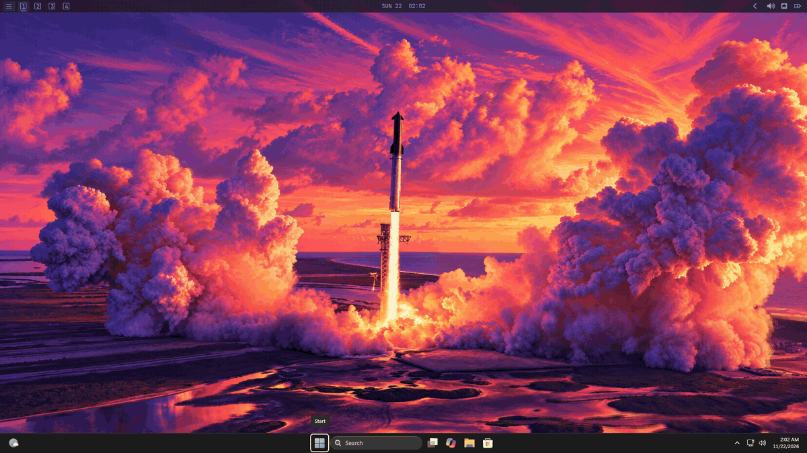
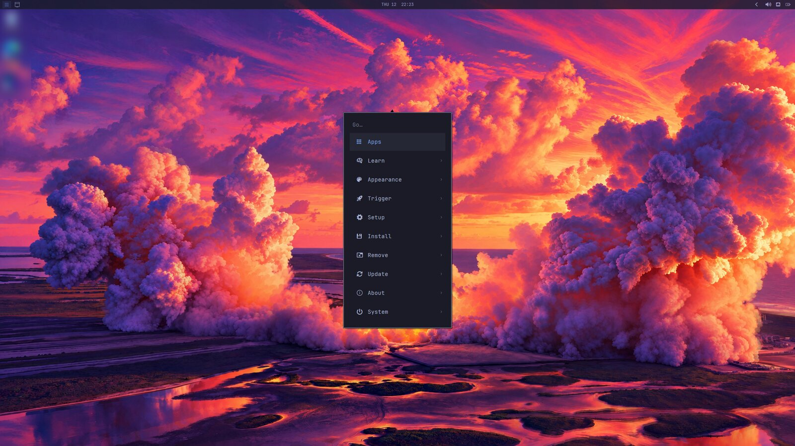
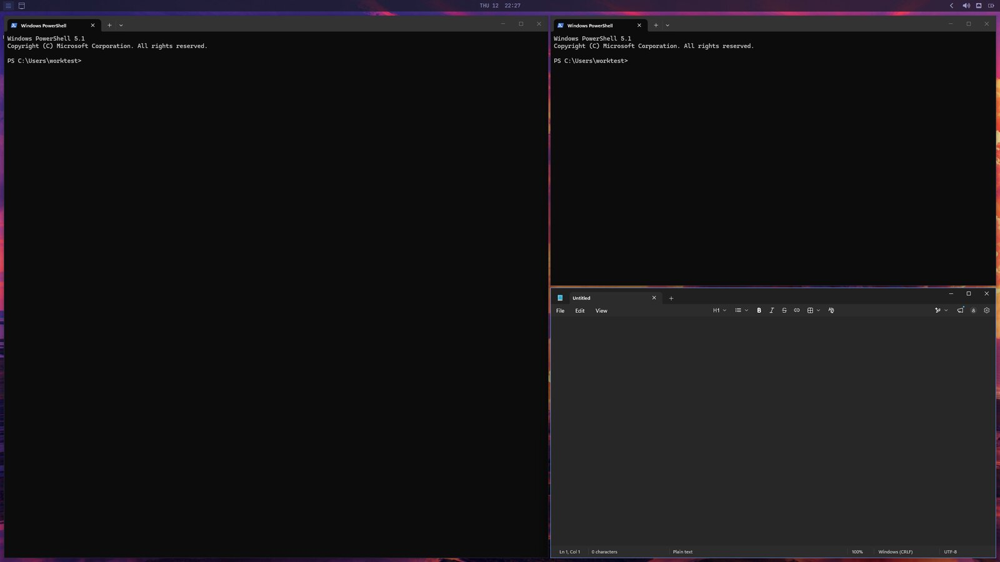
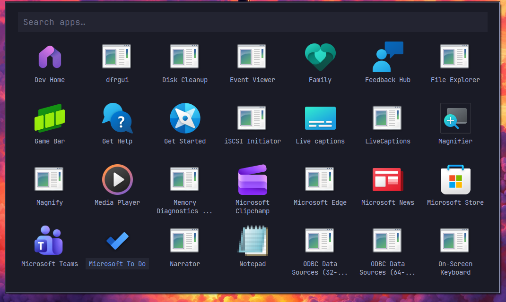

# Omarchy Overlay

A keyboard-first tiling window manager for Windows 11, inspired by the
[Omarchy](https://omarchy.org) desktop. It's written in Rust.
I built it because I have to use Windows at work and wanted the Omarchy workflow
there too. That is why it is built the way it is: a work PC is often locked down,
so the Standard edition runs from a folder with no installation and no administrator
rights, and it puts the taskbar and windows back if it exits or crashes. Where you
are an administrator, the Admin edition runs elevated so its keys also work in apps
running as administrator.

> **Not affiliated with Omarchy or its authors.** It's an independent project
> that brings an Omarchy-style workflow to Windows.



*Super + Return opens a terminal and it tiles; Super + Shift + L cycles the layouts.*



*Out of the box: Tokyo Night, Omarchy's default theme, with its first background,
the top bar and the menu (**Super + Space**).*



*Tiling in the default main-stack layout, with gaps and the 2 px border on the
focused window.*



*The app grid (**Super + Alt + Space**): type to filter, arrow keys move in the grid.*

**Status: early.** This is version 0.5.0. It comes in two editions built from the
same exe: **Standard** runs from its own folder with no installation and no
administrator rights; **Admin** installs itself and runs elevated.
Pick Standard on a PC where you are not an administrator, or to try it out. Pick
Admin on your own PC when its keys must also work in apps running as administrator.

## What it does

- **Tiles windows:** main-stack, columns, rows, grid, dwindle, a scrolling
  layout inspired by Niri, centered main for wide monitors and monocle. You can resize windows by dragging their shared edges.
- **Super keys:** an app grid, a command menu, a keybind list and window
  actions, defined in `config\binds.conf`.
- **Top bar:** ten workspaces of its own, the active app, a clock,
  a tray and modules.
- **Themes:** every stock Omarchy theme (Tokyo Night, the default, Catppuccin,
  Gruvbox, Nord and more) built in, plus a few extra themes, Mica and
  Acrylic materials and window opacity. It can apply the theme to Windows'
  own settings and puts the originals back on exit.
- **Runs from a flash drive:** the Standard edition needs no install, so it can
  run from a USB stick and take your settings with it. See below.
- **Recovery:** if the program exits or crashes, it restores the taskbar,
  window positions and transparency. `RECOVER.cmd` does the same by hand.

## Getting started

1. Install it in one of three ways. None needs administrator rights.
   - **Scoop:**
     `scoop bucket add omarchy-overlay https://github.com/matthewjaybarr-png/omarchy-overlay`,
     then `scoop install omarchy-overlay`. It adds **Omarchy Overlay** to the Start menu
     and keeps your `config` folder across updates.
   - **winget:** `winget install MattBarr.OmarchyOverlay`, then run `omarchy-overlay`
     (from Win + R or a terminal). Until the package is in winget's catalog, use
     Scoop or the zip.
   - **Zip:** download `OmarchyOverlay-<version>-standard.zip` from the
     [latest release](https://github.com/matthewjaybarr-png/omarchy-overlay/releases/latest)
     and unzip it anywhere. `SHA256SUMS.txt` on the release page has each zip's
     checksum. (Or build it; see below.)
2. Run `OmarchyOverlay.exe`. The menu opens at start. The exe is not code-signed yet,
   so Windows may warn the first time: choose **More info > Run anyway**, or **Run**.
3. Press **Super + Space** for the menu, **Super + Alt + Space** for the app grid,
   **Super + K** for every keybind and **Super + Escape** for the System menu.
4. To give every key back to Windows, choose **Trigger > Toggle > Pause Omarchy Overlay keys**.

Its logs and state are kept in `%LOCALAPPDATA%\OmarchyOverlay`.

### Running from a flash drive

The Standard edition runs from a USB stick: unzip it onto the stick and run
`OmarchyOverlay.exe` there. Nothing is installed on the PC and no administrator
rights are needed.

- **Settings on the stick:** by default settings are kept on each PC, in
  `%LOCALAPPDATA%\OmarchyOverlay`. To carry them with you, choose
  **Saved profiles > Profile files > Make this folder portable**, which saves them
  beside the exe. Or make a folder named `OVERLAY SETTINGS` beside the exe, or up to
  three folders above it: every copy and version on the stick then shares it, and
  pictures in it are kept without a drive letter, so they work whatever letter the
  PC gives the stick.
- **Removing the stick:** the tray menu adds **Exit before removing the stick**,
  which restores the desktop and exits so the drive can be pulled safely.
- **If the stick is pulled anyway,** Omarchy Overlay notices within a few seconds
  that its file is gone, puts the taskbar, windows and Windows appearance back, and
  exits. Windows keeps the whole program in memory when it starts from removable
  media, so it does not crash in the meantime.

### Admin edition

The Admin release has an `edition-admin` file beside the exe, which adds
**Install (admin)…** to the tray menu. Installing asks for administrator rights once, then:

- copies the exe, `fonts` and `RECOVER.cmd` to `%ProgramFiles%\OmarchyOverlay`;
- adds a logon task, **Omarchy Overlay**, that starts it elevated for the user who
  installed it, so its keys also work in apps running as administrator;
- adds a Start menu shortcut that runs that task, and an entry in **Settings > Apps**.

Apps you start from it still open without administrator rights.

**Updating:** run `INSTALL.cmd` (or **Update the installed copy…** in the tray) from
the newer release. The installer reads the installed version and:

- updates an older version, or asks first before replacing a newer one;
- closes the running copy, copies the new files beside the old ones and checks
  them, then swaps them in. If anything fails, every file is put back and the
  installed copy keeps working;
- removes files the new version no longer ships, and has Windows delete old files
  that were still in use at the next restart;
- keeps your settings, task and shortcut, and starts the new version.

Only one install or uninstall runs at a time. `--quiet` (for example
`INSTALL.cmd --quiet`) shows no messages; the exit code is 0 when done, 1 when it
failed and 2 when it was cancelled. Steps are written to the log.
**Uninstall…** in the tray (or Settings > Apps) restores the desktop and removes all
of it. The installed copy keeps its settings and config files in
`%LOCALAPPDATA%\OmarchyOverlay` and never uses an `OVERLAY SETTINGS` folder.
They are kept unless you run
`OmarchyOverlay.exe --uninstall --remove-settings`. From a prompt:
`OmarchyOverlay.exe --install` or `OmarchyOverlay.exe --uninstall`.

### Keys

- **Setup > Keymap** chooses **Super keys and Ctrl+Alt keys** (default),
  **Super keys only (Omarchy laptop)** or **Ctrl+Alt keys only**.
- Super keys come from `config\binds.conf`. Omarchy Overlay refuses Super + L,
  Ctrl + Alt + Delete and Ctrl-only keys. Plain Alt keys work, with a warning in
  the log, because they take the shortcut from the focused program.
- No app is special: every app, including CAD tools, follows its app rule.
- The default keys are stock Omarchy's: **Super + Space** opens the menu,
  **Super + Alt + Space** the apps, **Super + W** or **Super + Q** closes a
  window, **Super + M** minimizes it, **Super + Ctrl + Tab** goes back to the
  former workspace and **Super + K** lists every key.
- **Universal clipboard:** **Super + C / V / X / A** copy, paste, cut and select
  all in any app, as on Omarchy. In Windows Terminal, copy and paste send
  Ctrl + Shift + C / V so Ctrl + C still stops a command. Windows uses Super + C,
  V, X and A itself, so these need the Admin edition, which can take Super keys.
- Omarchy keys with no Windows meaning (groups, tmux, media and webcam keys) are
  left out. Omarchy's Super + L layout key is on **Super + Shift + L**, because
  Super + L stays with Windows' lock; **Super + Alt + L** cycles back.
- **Resize keys:** **Super + Minus / Equal** shrink or grow the focused tile's width,
  with **Shift** for its height, **Alt** for a little and **Ctrl** for a lot, as on
  Omarchy. They take over Windows Magnifier's keys, so **Super + Ctrl + Z** zooms in
  with Magnifier and **Super + Ctrl + Alt + Z** resets the zoom.
- **Super + Ctrl + D** opens Display settings, **Super + Ctrl + Alt + T** shows the
  time and **Super + Ctrl + Alt + B** the battery.
- **Full screen:** **Super + F** puts the focused window over its whole monitor,
  above the bar, and back; **Super + Alt + F** maximizes it. **Super + Alt + Home**
  saves a window's width and **Super + Home** puts it back.
- **Monitors:** **Ctrl + Alt + Tab** and **Ctrl + Alt + Shift + Tab** focus the next
  or previous monitor, and **Super + Shift + Alt + arrows** move every window on the
  focused monitor to the monitor in that direction.
- **Super + Backspace** toggles the focused window to 90% opacity.
- **Workspaces:** **Super + 1** to **Super + 0** show workspaces 1 to 10 and
  **Super + Shift + number** moves the focused window there. They are Omarchy
  Overlay's own, not Windows virtual desktops: windows of the other workspaces wait
  off-screen and still appear in Alt+Tab and on the taskbar, and choosing one shows
  its workspace. All monitors switch together. Pausing or exiting puts every window
  back.
- **Super + mouse wheel** goes to the previous or next workspace, as on Omarchy.
  It works with the Super keys on, not in the **Ctrl+Alt keys only** keymap.
- **Volume, brightness and more:** binds.conf can use `volume-up`, `volume-down`,
  `mute`, `brightness-up` and `brightness-down` (external monitors that accept
  DDC/CI; laptop screens are not changed), `mic-mute`, `toggle-gaps`, `show-time`
  and `show-battery`.
- **Super + left drag** moves the window under the cursor, and **Super + right drag**
  resizes it from the nearest corner, as on Omarchy. Dropping a tiled window on
  another tile swaps the two; a resized tile pushes its neighbours. Both work while
  tiling is on, with the Super keys on.
- After an Omarchy Overlay Super key, releasing Super does not open Start.
- Omarchy Overlay re-registers its key hook every 15 seconds, so a program started
  later (an AutoHotkey script, for example) cannot take its keys first. Keys it has
  no bind for still reach the other program.
- In the Standard edition, windows running as administrator do not pass keys to
  Omarchy Overlay; click an ordinary window first. The Admin edition has no such limit.
- **Setup > Keyboard conflicts** lists keys another program already holds, with
  free alternatives.

### Look

Out of the box Omarchy Overlay looks like Omarchy on Hyprland:

- A Waybar-style top bar: the menu and workspaces on the left, the clock in the
  middle, tray and status on the right, in JetBrainsMono Nerd Font.
- Square window corners with a 2 px border in the theme's active color on the
  focused window and its inactive color on the rest, with gaps between tiles.
- Walker-style menus: centred, square, a 2 px border, an 84% opaque
  background, a faded search line at the top and the selected row in the
  theme's accent color.
- The app picker is a grid like Omarchy's launcher: 7 columns of large app icons
  with their names under them, 4 rows at a time. Type to filter; the arrow keys
  move left, right, up and down, Page Up/Down and the mouse wheel scroll by rows.
- The theme sets the Windows accent color and its first background, at start
  and whenever you choose one. **Super+Ctrl+Space** opens the background switcher for the theme's
  `backgrounds` folder. The Admin edition ships Omarchy's backgrounds for every theme in
  `themes\<id>\backgrounds` beside the exe.

- **Appearance > Window corners** draws every window with square, round or
  slightly round corners, or leaves them as Windows draws them.
- **Background > Apply to** sets a background on one monitor only (counted left to
  right) instead of all of them.
- **Right-click an app on the bar** to close it.

Every Windows setting this changes is recorded first and restored on exit, from
the recovery menu, and after a crash.

### Windows behavior

**Appearance > Windows behavior** switches Windows settings that get in the way
of a tiling setup. Each line shows whether it is on now; **Enter** flips it:

- the taskbar on the left or centred, its Task View button and its search box;
- File Explorer showing file extensions and hidden files;
- Windows Snap, the snap layouts flyout, the snap bar at the top of the screen and
  Snap Assist;
- focus follows the mouse, and window animations.

Every original value is recorded before the first change and put back on exit,
by **Restore** at the bottom of the page, from the recovery menu and after a crash.

### Monitors

With **Layout > Remember layout, main share and gap for each set of monitors** on, Omarchy Overlay
keeps the layout, main pane size and gap for each set of monitors it has seen,
and switches to them when you dock, undock or plug in a screen.

### Changing the bar, and going back to defaults

- **Appearance > Top bar > Icons or text** shows the whole bar as icons (Omarchy's
  look, with the clock and window title as text), icons and text, or text. Below
  those, each item on the bar is listed; Enter steps it between icon, icon and
  text, and text. Choosing an item under **Bar items** offers the same choice.
- Every settings page ends with **Undo changes** and **Restore defaults**.
  **Bar items** restores the default layout and **Icons or text** the default icons.
- **Appearance > Top bar > Reset the top bar** puts the whole bar back: items,
  icons, height, clock and opacity.
- **Setup > Reset all settings** puts every setting back to its default. Saved
  profiles and your config files are kept, and the old settings are saved first as
  `profile-backup.json` in `%LOCALAPPDATA%\OmarchyOverlay`.

If you keep your own `config\menu.json`, add these entries to it from
`config\examples\menu.json`.

### Apply theme to Windows

Choose **Appearance > Apply theme to Windows**. Each line shows the current
value; **Enter** changes it.

- Windows dark/light mode, Transparency effects, Accent color on Start and taskbar.
- **Accent color** shows the theme's accent (Tokyo Night: `#7AA2F7`). The theme
  sets it as the Windows accent too; the original returns on exit.
- **Other apps' window frames follow the theme** gives other programs a dark
  frame with the theme's border and caption colors. **Mica or Acrylic** adds a
  material; if Windows transparency is off, Omarchy Overlay says blur will look solid.
- **Background** and **Windows Terminal colors** are on the same page.
- **Restore the original Windows appearance** puts every original value back.
  Omarchy Overlay records the originals first and also restores them on exit and after
  a crash.
- **Apps Omarchy Overlay cannot theme** lists Office, Teams, Chrome/Edge and CAD programs
  with where each one's own theme setting is.

### Windows that always float

**Setup > Tiling > Always-float list** shows the built-in entries (Run, Open
With, Properties, file copy/move/delete progress, replace and confirm prompts)
and your own. **Add an open window** picks one from the windows that are open.
Switching a built-in entry off asks twice. These windows are never tiled and
stay where Windows opens them.

### Web apps

Omarchy's web app keys work the same way: **Super + Shift + A** ChatGPT,
**Super + Shift + Alt + A** Grok, **Super + Shift + G** WhatsApp (Signal has no
web app), **Super + Shift + Y** YouTube, **Super + Shift + P** Google Photos,
**Super + Shift + S** Google Maps and **Super + Shift + X** X. If no
window is open, Omarchy Overlay starts the app from Chrome's **Chrome Apps** Start-menu
folder; if that shortcut is missing it offers to open the site. To make the app:
open the site in Chrome, then **⋮ > Cast, save and share > Install page as app**.

## Config files

Omarchy Overlay reads these files from the `config` folder beside `OmarchyOverlay.exe`
(the installed Admin edition and a winget install use
`%LOCALAPPDATA%\OmarchyOverlay\config` instead: the Admin folder needs administrator
rights to change, and winget replaces its folder on every upgrade).
Every file is optional. Omarchy Overlay writes only `config\examples` (refreshed at each
start) and never changes your copies. To change a file, copy it from
`config\examples` into `config`, edit it in Notepad, then choose **Update >
Config > Reload config files**. If a file has a mistake, Omarchy Overlay keeps the
built-in version; the first line of the menu then says how many files have
problems, and **Update > Config > Config file problems** lists each file and line.

| File | Controls |
| --- | --- |
| `config\binds.conf` | Super keybinds |
| `config\menu.json` | The menu: lists, labels, icons, order and commands |
| `config\webapps.json` | Web apps for the `webapp` command |
| `config\always-float.json` | Built-in always-float entries switched off, and your own windows |
| `config\themes\` | Extra or replacement themes, as `<name>.toml` files or Omarchy theme folders |

### binds.conf

One key per line: key, description, command. Lines starting with `#` are notes.
Keys are written `Super+Shift+A`; modifiers are Super, Ctrl, Alt and Shift.

```text
Super+Return, Terminal, app terminal
Super+Shift+E, Email, app email
Super+Shift+A, ChatGPT, webapp ChatGPT
Super+1, Switch to workspace 1, workspace 1
```

### menu.json

A list of menus. Each has an `id`, a `title` and `items`; each item has a
`label`, an `icon` (a Nerd Font code in hex, optional), a `command` and optional
`"confirm": true` (Enter twice). The menu with id `main` is the top level;
`menu <id>` opens another one.

```json
{
  "menus": [
    {
      "id": "system",
      "title": "System",
      "items": [
        { "label": "Lock", "icon": "F023", "command": "lock" },
        { "label": "Shut down", "icon": "F011", "command": "shutdown", "confirm": true }
      ]
    }
  ]
}
```

### webapps.json

```json
{
  "apps": [
    { "name": "ChatGPT", "url": "https://chatgpt.com", "shortcut": "ChatGPT", "window_title": "ChatGPT" }
  ]
}
```

`shortcut` is the name in the Start menu's Chrome Apps folder; `window_title` is
text in the app window's title.

### always-float.json

```json
{
  "disabled": [],
  "windows": [
    { "executable": "calc.exe", "window_class": "", "title_contains": "" }
  ]
}
```

`disabled` takes `run`, `open-with`, `properties`, `file-operations` and
`confirm-prompts`. Each window needs a program, a window class or title text.

### themes

The built-in themes are the stock Omarchy themes, embedded from their
`colors.toml` files, plus a few extras that are not part of stock Omarchy (Aether,
Alpenglow Night, Haunted Town, Machine Shop, Neon Ridge and Purple Mountain).
Tokyo Night, Omarchy's default, is the theme of a new setup. Add or replace a theme in either form:

- `config\themes\<name>.toml`: an Omarchy `colors.toml` file; the file name
  is the theme name.
- `config\themes\<name>\colors.toml`: an Omarchy theme folder, copied as it
  is from `~/.config/omarchy/themes/<name>` on an Omarchy machine. A
  `backgrounds` folder beside it is kept with the theme.

A theme with the same name as a built-in one replaces it. Keys Omarchy adds
later are ignored, so newer Omarchy themes still load.

```toml
accent = "#7daea3"
background = "#282828"
foreground = "#d4be98"
mode = "dark"
```

`scripts/import_omarchy_themes.py` refreshes the embedded themes from an
Omarchy install; `--out DIR` also writes theme folders to copy to a PC.

### Commands

Used in binds.conf and menu.json.

| Command | Does |
| --- | --- |
| `apps` | Open the app picker |
| `menu` | Open the Omarchy Overlay menu |
| `keybinds` | Show all keybinds |
| `open-windows` | Search open windows |
| `window-panel` | Compact panel for the selected window |
| `reload-config` | Reload config files |
| `restart` | Restart Omarchy Overlay |
| `exit` | Restore the desktop and exit Omarchy Overlay |
| `pause-keys` | Give all keys back to Windows until resumed |
| `toggle-bar` | Show or hide the top bar |
| `keep-awake` | Keep the screen awake |
| `lock` | Lock the PC |
| `sleep` | Sleep |
| `sign-out` | Sign out of Windows |
| `restart-pc` | Restart the PC |
| `shutdown` | Shut down the PC |
| `task-view` | Windows Task View |
| `notifications` | Windows notifications |
| `quick-settings` | Windows Quick Settings |
| `copy`, `paste`, `cut`, `select-all` | Universal clipboard: Ctrl + C, V, X or A once Super is released |
| `clipboard` | Windows clipboard history |
| `emoji` | Windows emoji panel |
| `capture` | Screenshot or screen recording (Snipping Tool) |
| `next-desktop` | Next workspace |
| `former-desktop` | Former workspace |
| `minimize-window` | Minimize the focused window |
| `previous-desktop` | Previous workspace |
| `move-to-desktop` | Opens Windows Task View |
| `apply-windows-theme` | Apply the theme to Windows |
| `restore-windows-appearance` | Restore the original Windows appearance |
| `update-profile` | Update the active profile from current settings |
| `guide` | Open the Omarchy Overlay guide |
| `log` | Open the Omarchy Overlay log |
| `config-folder` | Open the config folder |
| `releases-folder` | Show where Omarchy Overlay releases are kept |
| `volume-up`, `volume-down`, `mute` | Change the volume or mute it |
| `mic-mute` | Turn the default microphone off or back on |
| `zoom-in`, `zoom-reset` | Zoom in with Windows Magnifier, or close it |
| `cycle-layout-back` | Cycle the workspace layout backwards |
| `full-screen` | Put the focused window over its whole monitor, or back |
| `save-width`, `restore-width` | Save the focused window's width, or put it back |
| `focus-next-monitor`, `focus-previous-monitor` | Focus the top window on the next or previous monitor |
| `move-workspace-left`, `-right`, `-up`, `-down` | Move every window on the focused monitor to the monitor in that direction |
| `brightness-up`, `brightness-down` | Change the brightness of every external monitor that accepts DDC/CI |
| `toggle-gaps` | Turn the gaps between tiles off or back on |
| `show-time`, `show-battery` | Show the time or the battery level on screen |
| `restore-desktop` | Restore every window to its original place |
| `reset-bar` | Reset the top bar to its defaults (asks first) |
| `reset-settings` | Reset all settings to defaults; saved profiles are kept (asks first) |
| `menu <id>` | Opens that list of menu.json, for example `menu system` |
| `page <id>` | Opens a settings page: `theme`, `font`, `background`, `gaps`, `main-size`, `layout`, `columns`, `opacity`, `inactive-opacity`, `materials`, `animations`, `focus-outline`, `osd`, `app-rules`, `default-rule`, `add-rule`, `always-float`, `always-float-add`, `bar`, `bar-items`, `bar-style`, `clock`, `bar-height`, `bar-opacity`, `workspace-layouts`, `keyboard`, `conflicts`, `keymap`, `tap-super`, `taskbar`, `profiles`, `windows-theme`, `windows-checklist`, `webapps`, `install-webapp`, `remove-apps`, `custom-apps`, `version`, `terminal-colors`, `config-errors`, `corners`, `windows-tweaks` |
| `app <role>` | Starts or shows an app: `terminal`, `browser`, `browser-private`, `files` (the file manager Windows opens folders with), `explorer` (File Explorer itself, at This PC), `email`, `new-email`, `calendar`, `teams`, `editor`, `calculator`, `activity` (Task Manager), `music` |
| `webapp <name>` | Brings a web app from webapps.json forward |
| `workspace <1-10>` | Shows that workspace |
| `move-to-workspace <1-10>` | Moves the focused window to that workspace and goes there |
| `move-to-workspace-silent <1-10>` | Moves the focused window to that workspace and stays |
| `layout <name>` | `main-stack`, `columns`, `rows`, `grid`, `dwindle`, `scrolling`, `centered`, `monocle` |
| `theme <name>` | Switches theme, for example `theme tokyo-night` |
| `settings <page>` | Opens a Windows Settings page, for example `settings sound` |
| `resize width\|height <pixels>` | Resizes the focused tile, for example `resize width -100` |
| `action <id>` | Runs a window action, for example `action close-window` |
| `launch <file> [arguments]` | Runs a program or script stored inside the config folder, as you |


## Build and check

On Windows, with Rust (rustup.rs) and Visual Studio 2022 Build Tools
("Desktop development with C++"):

```powershell
rustup target add x86_64-pc-windows-msvc
cargo test
cargo build --release --target x86_64-pc-windows-msvc
```

The program is built to `target\x86_64-pc-windows-msvc\release\OmarchyOverlay.exe`.

On Linux, with cargo-xwin:

```sh
cargo test
cargo clippy --target x86_64-pc-windows-msvc -- -D warnings
cargo xwin build --release --target x86_64-pc-windows-msvc
```

The `tests\windows-*.ps1` scripts are integration tests for a real Windows
desktop. They open disposable windows and turn tiling on, so run them on a test
machine or VM, never on a desktop you're using. `scripts/test_windows.py` runs
them in a libvirt Windows guest through `scripts/vm.py`. Set `OVERLAY_VM`,
`OVERLAY_VM_USER` and `OVERLAY_VM_GUEST` to match your VM.

### Releases

After the release build, `python3 scripts/package.py` writes two zips to `dist\`
from the same exe, and `SHA256SUMS.txt` with their checksums:

- `OmarchyOverlay-<version>-standard.zip`: the exe, `RECOVER.cmd`, `fonts\` and
  `config\examples\`. Unzip and run; no administrator rights.
- `OmarchyOverlay-<version>-admin.zip`: the same, plus `INSTALL.cmd` and the
  `edition-admin` marker. Run `INSTALL.cmd` to install (see Admin edition).

`python3 scripts/package.py --selftest` checks both file lists and that the two exes match.
Two VM suites test the zips and are not in the default list: `standard` runs the
Standard release with a limited token, and `install` installs the Admin release,
checks it, and uninstalls it (it runs elevated, so the VM user must be an administrator).

## Contributing

Bug reports, ideas and pull requests are welcome; see [CONTRIBUTING.md](CONTRIBUTING.md).

## License

Copyright (c) 2026 Matt Barr. GPL-3.0-only: you may share and change Omarchy
Overlay under the GNU General Public License version 3. See [LICENSE](LICENSE).
Releases up to 0.4.0 were published under the MIT License.
The stock Omarchy themes and backgrounds stay under Omarchy's MIT License.
