# Test results

Newest first. Written by the Windows session; see README.md.

## Build 24 (b9c7aac) — 2026-11-26 14:05 UTC, Windows 11 VM, Standard, by hand

Release artifact from run 45790986756 (SHA256SUMS OK). Admin not run.

- **MRG1** PASS. Fresh portable folder from the real 0.6.0 standard zip, started 0.6.0
  once, exited, copied 0.6.0's `examples\menu.json` to `config\menu.json` (hash
  ece976370cfa0db1, same as the 0.6.0 zip); no `config\.defaults`. Unzipped build 24
  over it (`Expand-Archive -Force`) and started:
  - `config\menu.json` has Window gaps, One-window square and Screensaver and idle
    lock, and is valid JSON; `menu.json.before-0.6.0` appeared beside it.
  - `config\.defaults` holds `binds.conf` and `menu.json`, identical to the shipped
    examples (576665C23D33…, 48B3ADA12963…).
  - Toggle page (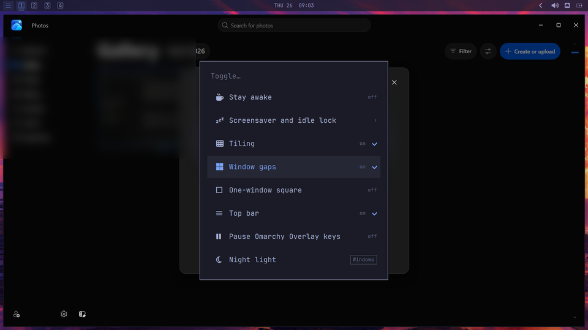): the new rows sit where the merge put
    them in the user's 0.6.0 order (Stay awake, Screensaver and idle lock, Tiling, Window
    gaps, One-window square, Top bar, Pause keys, Night light), not build 23's fresh
    order. Expected for a merged copy, just noting it.
  - Deleted the Window gaps line from `config\menu.json`, restarted: still gone, and
    `.defaults` unchanged. Unzipped build 24 over the folder again, restarted: still gone
    (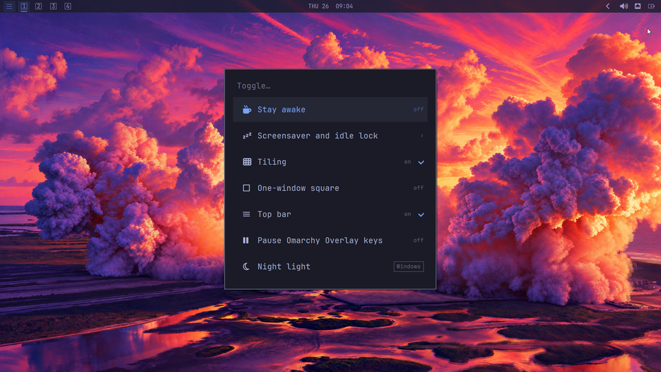).
- **NL2** PASS. Setup > Keybinds shows "Num Lock on at start" in full with "as Omarchy"
  beside it (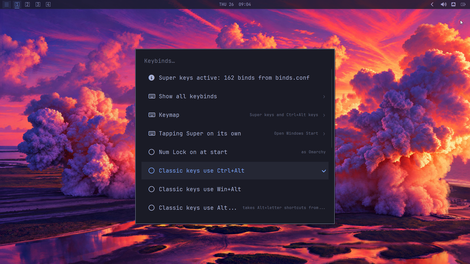). The "Classic keys use Alt…" row below it is still
  cut off ("takes Alt+letter shortcuts from…").

## Build 23 (1d56ea3) — 2026-11-26 07:40 UTC, Windows 11 VM, Standard, by hand

Release artifact from run 45773864568 (SHA256SUMS OK), portable folder, clean settings
folder, 125% scaling. Covers build 22's NL1 and TUI1 too. Admin not run.

- **NL1** PASS. With Num Lock off, Setup > Keybinds > "Num Lock on at start" ticks, says
  "Saved." and turns Num Lock on at once; config.json gets `num_lock: true`
  (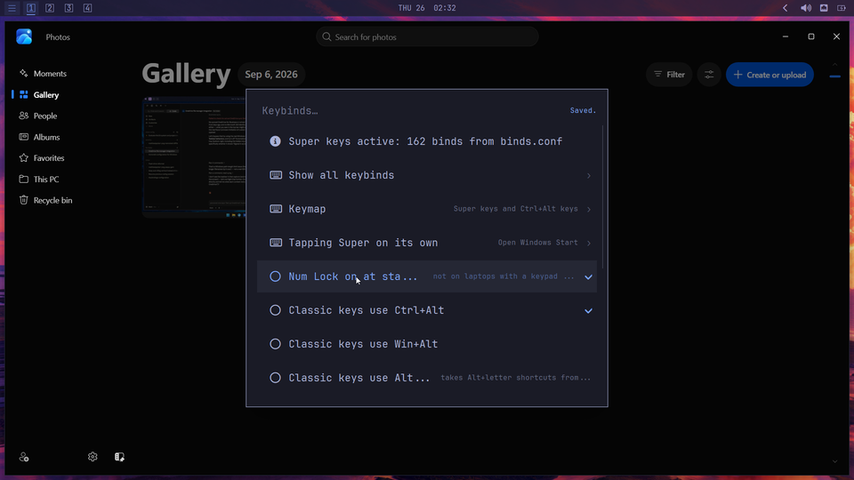). Num Lock off, exit, start: it comes back on. Unticked
  (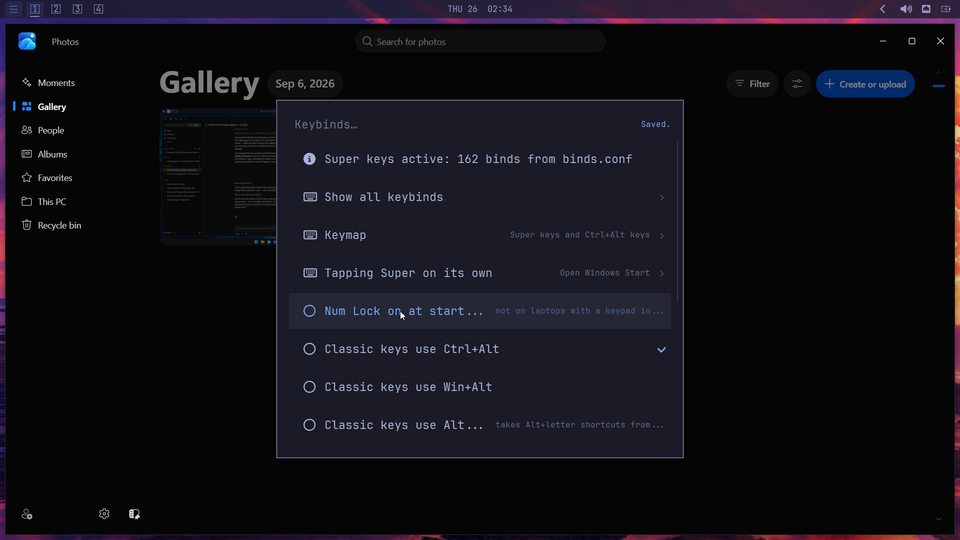), Num Lock off, exit, start: it stays off (`num_lock: false`).
  The label is cut off ("Num Lock on at start..."), and so is its hint ("not on laptops
  with a keypad in..."): another one for the label pass.
- **TUI1** PASS (Windows Terminal 1.25.3131.0). Install > Custom apps > Add a terminal app,
  `cmd /k echo hello`, Enter: "Added Cmd.", named Cmd, path is `wt.exe` and shows
  "available" (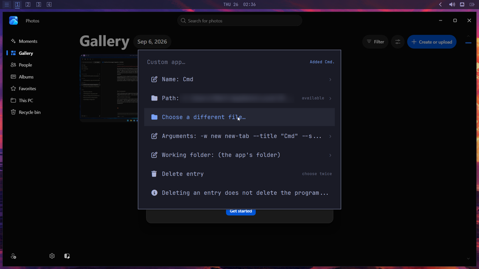, path blurred). Saved arguments:
  `-w new new-tab --title "Cmd" --suppressApplicationTitle cmd /k echo hello`. Picking Cmd in
  the app picker opens a new tiled Terminal window titled Cmd showing hello
  (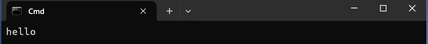). `powershell -NoExit -Command "echo a; echo b"` becomes
  Powershell, with the `;` escaped as `\;` for wt, and prints a and b on two lines
  (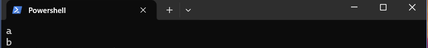).
- **TOG1** PASS for the menu itself. Trigger > Toggle lists Stay awake, Screensaver and
  idle lock, Night light, Top bar, Tiling, Window gaps, One-window square, Pause Omarchy
  Overlay keys (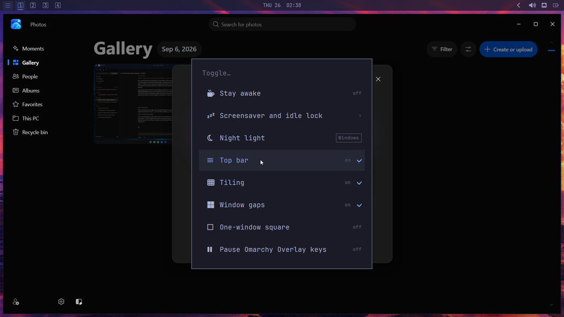). Window gaps off removes the gaps and the row
  says off (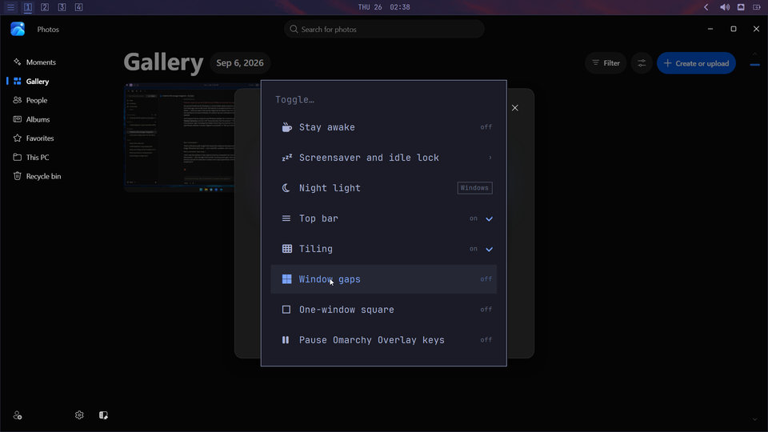); on again brings them back. One-window square
  with Photos as the only tiled window makes it square (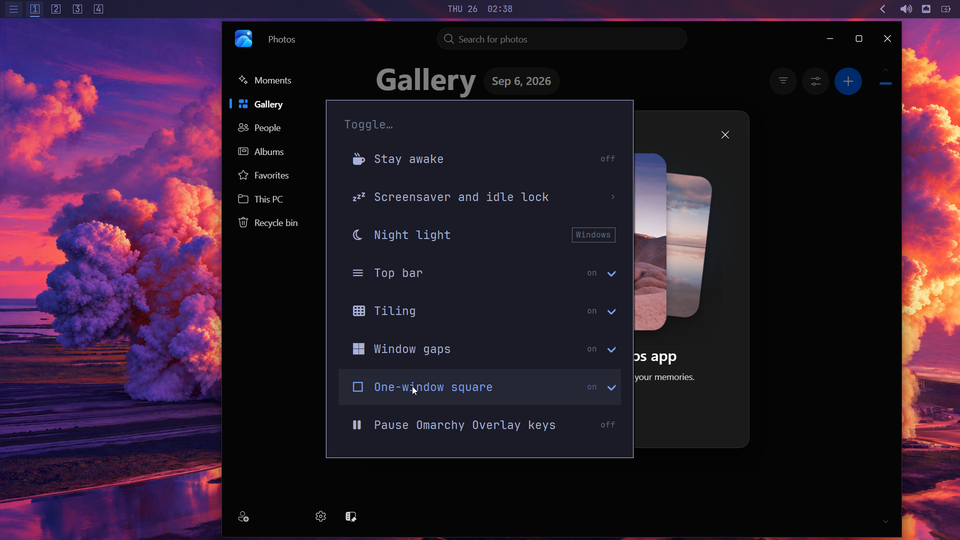)
  and then fills again. Screensaver and idle lock opens its page
  (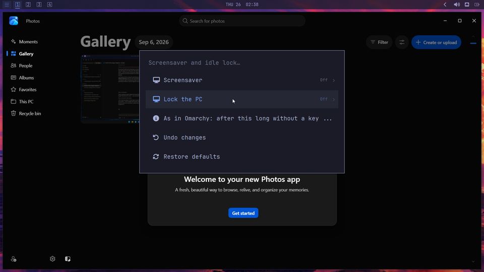).
- **TOG1 merge** PASS when 0.6.0 ran in the folder last: 0.6.0's menu.json as both
  `config\menu.json` and `config\examples\menu.json`, then start 23. The file gets the three
  new rows, keeping 0.6.0's order with them added (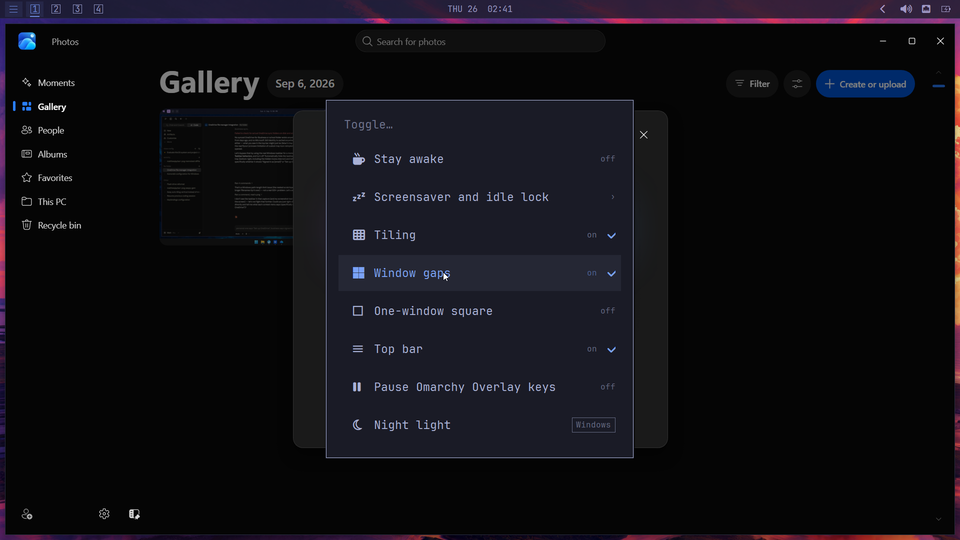).
- **TOG1 merge FAILS when the new zip is unzipped over the old folder.** The zip
  contains `config\examples\menu.json`, so unzipping it replaces the base with 23's
  version. With 0.6.0's `config\menu.json` and 23's examples, the merge sees the new rows
  in the base but not in the user file, treats them as deleted by the user, and leaves the
  file alone (hash unchanged). Toggle shows only 0.6.0's five rows
  (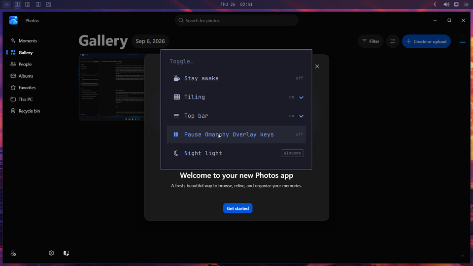). This is how a portable user would normally
  upgrade. binds.conf takes its base from the same `examples` folder (`config_folder.rs`, `load()`), so new keys are probably lost the same way (not tested).
- Note for testers: the portable build's config folder is next to the exe
  (`<folder>\config`), not `%LOCALAPPDATA%\OmarchyOverlay\config`. A menu.json put in the
  settings folder is ignored.

## Build 21 (a007f0c) — 2026-11-26 06:15 UTC, Windows 11 VM, Standard, by hand

Release artifact from run 45750797337 (SHA256SUMS OK), clean settings folder, 125% scaling, bar on top.

- **TT1 clock** PASS. Hover shows "THU 26 01:12 / Open the calendar"; the click hides it,
  and it stays hidden with the calendar open, both with the pointer still for 4 s and after
  moving it a few pixels. After Esc, hovering shows the tooltip again
  (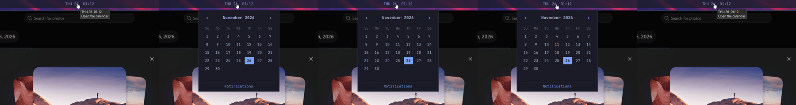: hover, open, still, moved, after close).
- **TT1 volume** PASS. Same sequence with the sound panel: "VOL 86% / Click: sound panel ·
  Scroll: volume · Middle-click: mute" on hover, none while the panel is open (still and
  moved), back after Esc (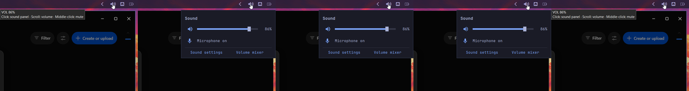).
- Admin edition not run for TT1 (same bar code; only Standard was queued).

## Build 20 (1de29fb) — 2026-11-26 03:45 UTC, Windows 11 VM, Standard, by hand

Clean settings folder, stock Tokyo Night, 125% scaling, Windows' first weekday Sunday.

- **CAL1** PASS. The clock opens the calendar under it in the theme colors, today (25)
  in the accent, week starting Sunday. Wheel down/up, ‹ ›, PageUp/PageDown,
  Left/Right and Home change the month as expected; clicking the month name returns to
  today (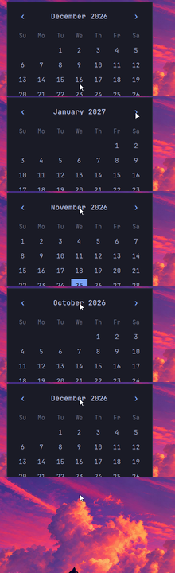, 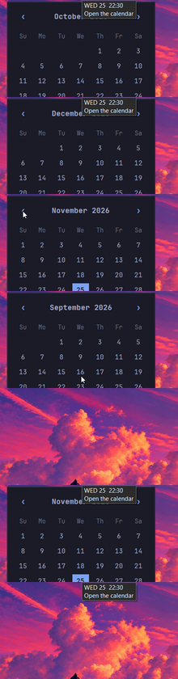). Escape, a desktop
  click and a second clock click all close it, and the clock click doesn't reopen it.
  Reopening starts on today's month. "Notifications" opens Windows' notification panel.
  With `bar.position` "bottom" it opens above the bar (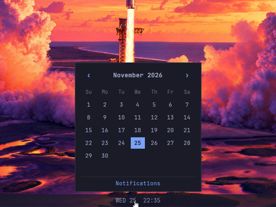).
  At 125% it is sharp; 150% not tried.
  - Small: the clock's tooltip ("WED 25 22:29 / Open the calendar") stays up over the
    month header after the click (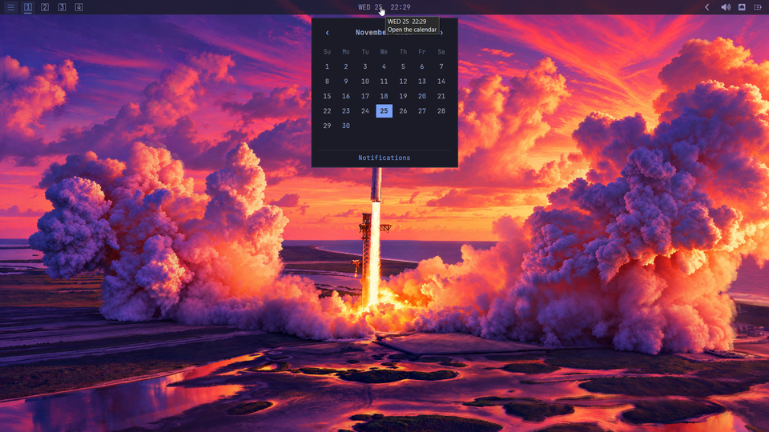); the volume tooltip
    does the same over the sound panel's "Sound" title.
- **SND1** PASS, checked against Windows' own endpoint volume (Core Audio, read in
  Matt's session) and Settings > Sound. Slider click 23%, drag 83%, wheel 2% a notch,
  Left/Right 5% a press; Windows matched each time and Settings showed 86 when the
  panel did. M and the speaker icon mute and unmute (Windows mute true/false); the
  microphone row mutes and unmutes the default mic (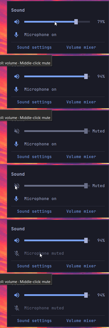).
  "Sound settings" and "Volume mixer" open those pages. Escape and an outside click close it.
  - "No microphone" SKIP: disabling the VM's only input (Line In) with
    `Disable-PnpDevice` left Windows still reporting a default capture device, so the
    panel rightly kept saying "Microphone on". Re-enabled afterwards.
- **Not a bug, for the record:** after `Stop-Process -Force` and a restart, the Windows
  taskbar stayed shown over a bottom bar until I clicked the desktop: the taskbar had
  keyboard focus ("Start" tooltip). It hid itself once focus moved.
- README screenshots pushed to forge as 244145d: `docs/screenshots/calendar.png` and
  `sound-panel.png` (stock theme, no cursor, nothing private). The README doesn't
  reference them yet.

## Release 0.6.0 (v0.6.0, 923bbeb) — 2026-11-26 03:10 UTC, Windows 11 VM, release zips

The release's own zips from GitHub (SHA256SUMS.txt OK), run with the v0.6.0 tests as Matt.

- **All 25 suites PASS**: the 23 default suites with the Standard exe, plus `standard`
  (19 checks) and `install` (Admin zip, 36 checks); 719 checks in all.
- **tray** flaked twice right after boot, on a different auto-hide check each time
  ("Tray button opens Explorer's real popup", then "repeated bar click dismisses
  popup"). After that, 0.5.0 (build 18) and 0.6.0 alternating each passed all 48 checks
  twice, so it is the same timing flake as before, not a 0.6.0 regression.

## Build 18 (5d9cfff) — 2026-11-25 20:18 UTC, Windows 11 VM, Standard

- **N1** PASS. System > Restart into BIOS/UEFI shows the themed card at the top of the
  screen, "Restarting into the firmware (BIOS/UEFI) setup needs the Admin edition, which
  runs with administrator rights." (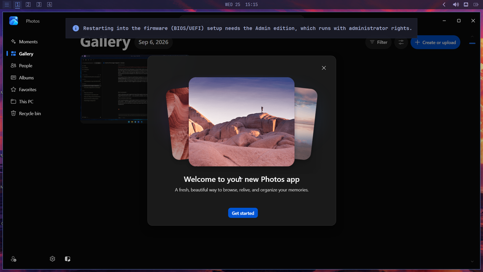). No message box; the card
  was gone 8 s later, and the same text is in `omarchy-overlay.log`. With
  Appearance > On-screen messages > "No on-screen messages" (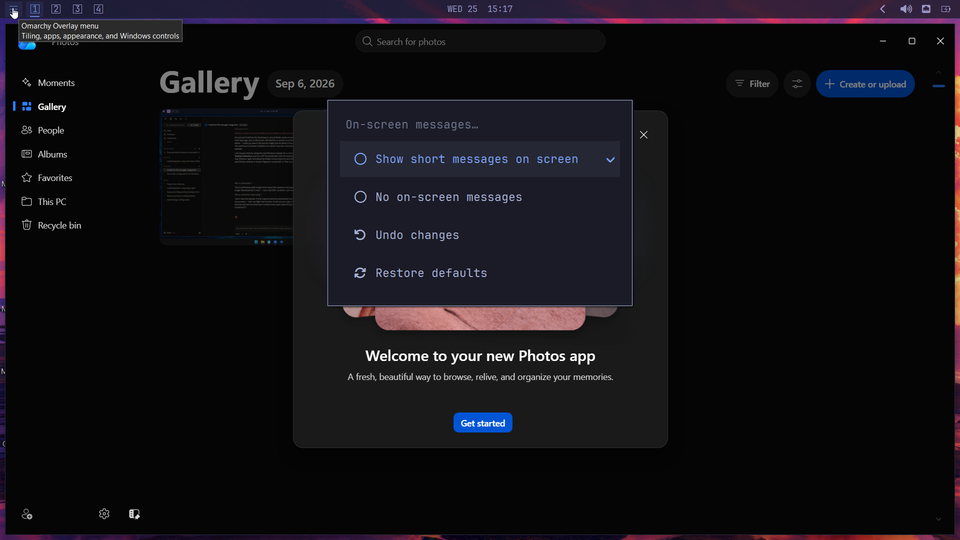;
  it's under **Appearance**, not Setup), the same item shows the plain message box again
  (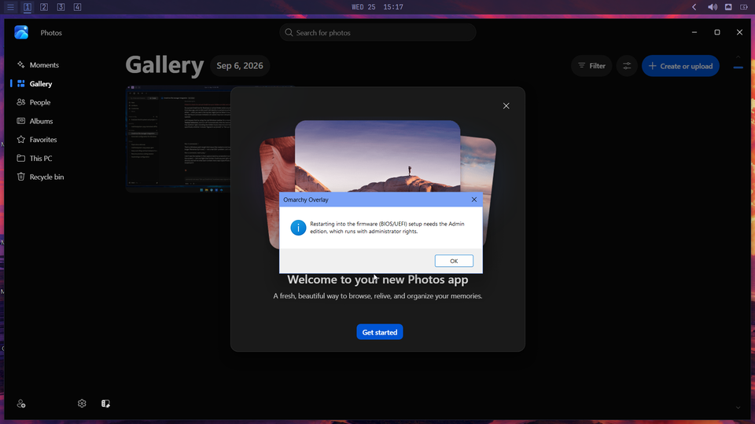). Turned back on afterwards.
- **Failing-command check not done.** Setup > Saved profiles > a built-in profile has no
  "Update" item at all (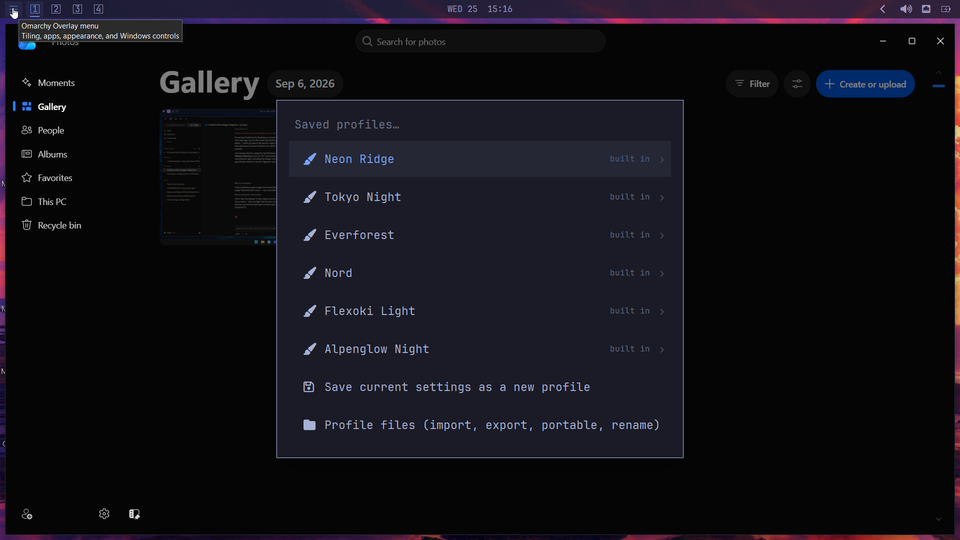), so the menu can't reach
  update-profile's "Built-in profiles cannot be changed" notice; it seems only reachable
  from a key binding. I didn't hunt for a web app without a browser link.

## Build 17 (ed103be) — 2026-11-25 19:56 UTC, Windows 11 VM, Standard and Admin

Started from a settings folder holding only a leftover `lock-screen-original.jpg` (the
build 16 folder is `OmarchyOverlay-old-16`).

- **Start blocker** PASS. The Standard overlay started normally and the welcome menu
  opened (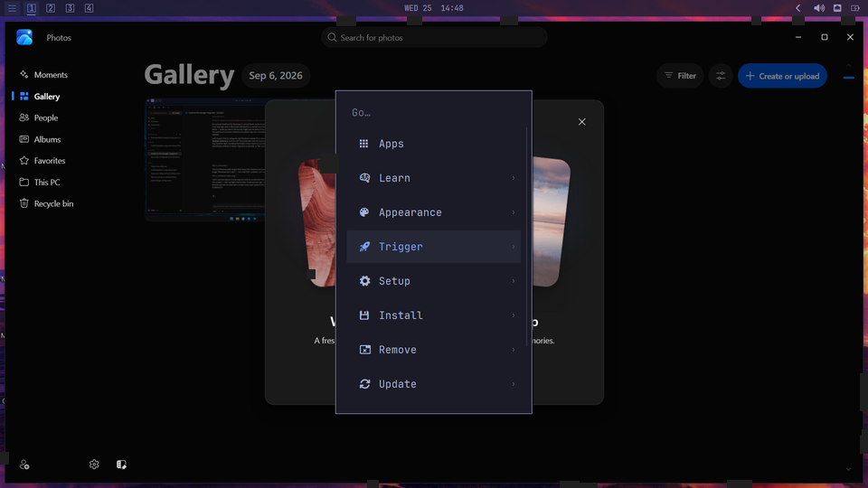). The leftover `lock-screen-original.jpg` was dropped:
  the folder had no such file after the start.
- **LS1 (Standard, Windows 11 Home)** PASS. Appearance > Apply theme to Windows > Lock
  screen picture > "Lock screen shows the theme background" says "Set. Lock the PC
  (Win+L) to see it." (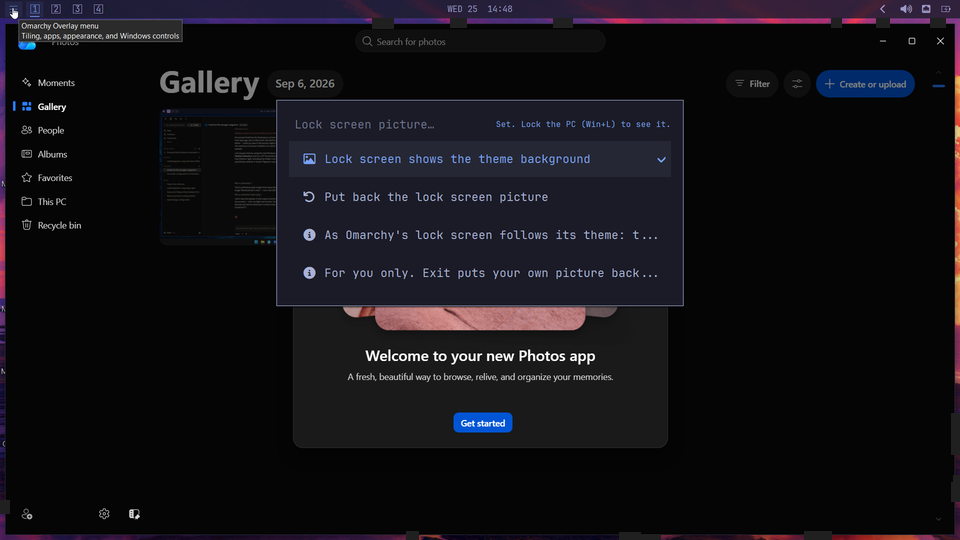). Win+L shows Tokyo Night's liftoff
  background (). The folder then had `lock-screen-changed`
  and `lock-screen-original.jpg`. **No log lines**: `Select-String` for
  "lock screen|LockScreen|HRESULT" on `omarchy-overlay.log` finds nothing, before or after
  exit, so there is no HRESULT to paste (it worked, so presumably nothing was logged).
  Exit (Update > Process > Restore desktop and exit) put the Windows picture back
  (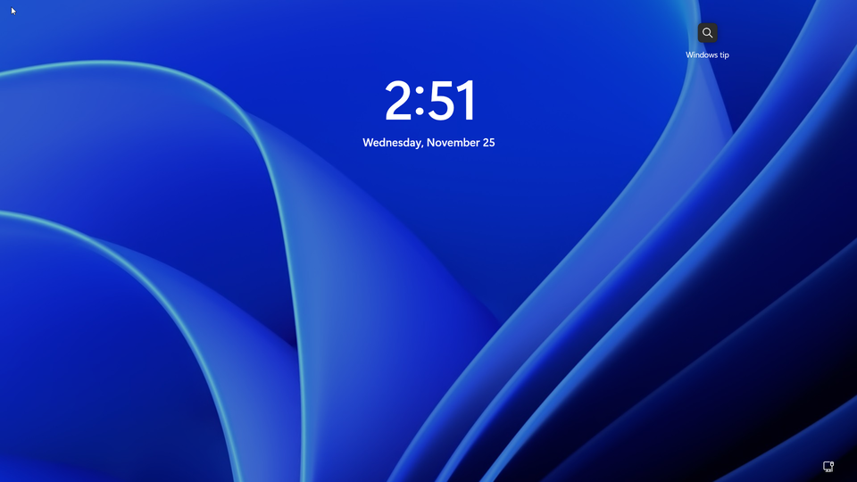) and removed both files.
- **TL1** PASS: every window tiles. 17 windows (15 Notepads, Photos, a short-lived
  Terminal). Main + stack (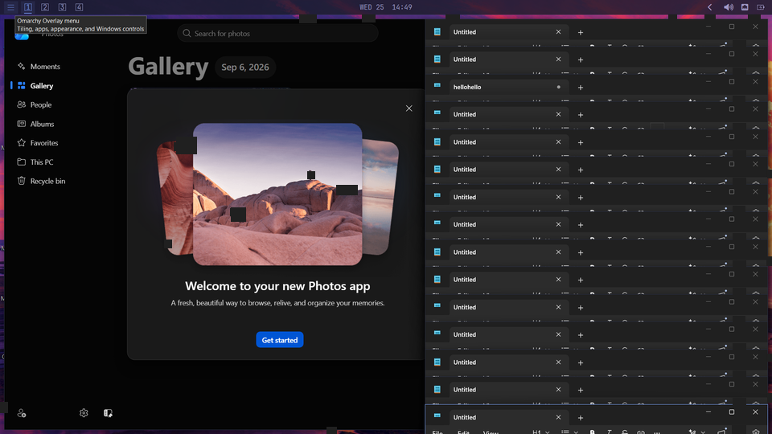), Columns, 16 of about 118 px
  (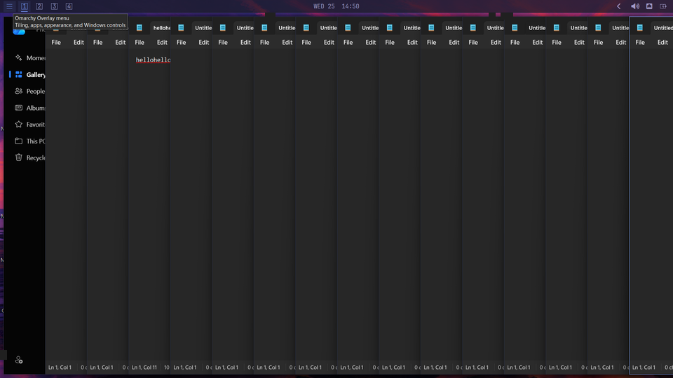), Rows, 16 of about 64 px (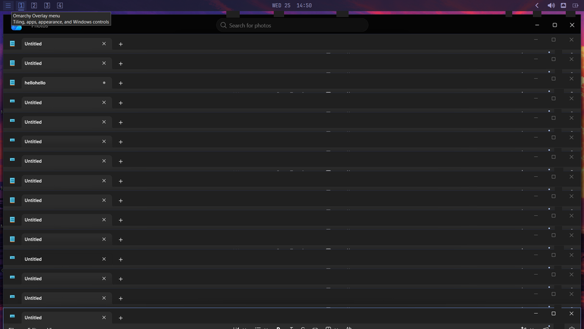) and Grid
  4x4 (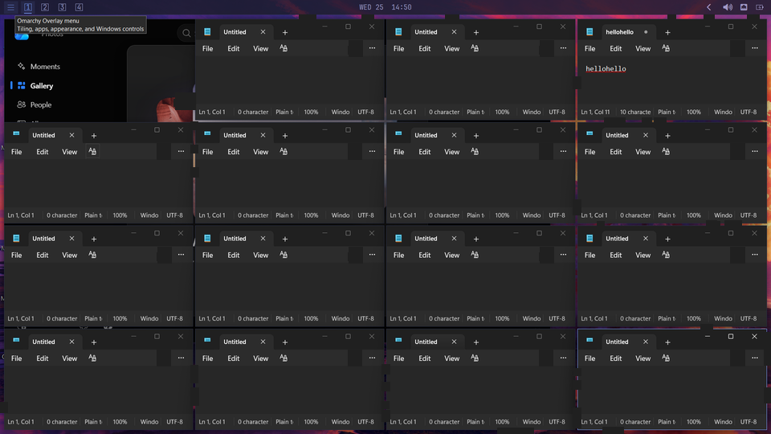) all place every window. Notepad will not shrink below
  about 240x130 px, so in Columns and Rows the windows overlap and the last one runs past
  the right or bottom edge. That's Notepad's minimum size, not the layout.
- **A2 Standard** PASS. System > Restart into BIOS/UEFI asks nothing and shows a message
  box: "Restarting into the firmware (BIOS/UEFI) setup needs the Admin edition, which
  runs with administrator rights." (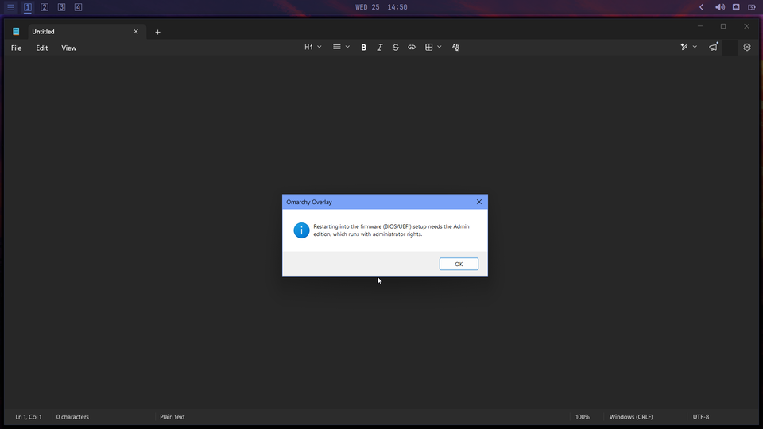). It's a plain unthemed
  Windows message box, unlike the rest of the menus.
- **A2 Admin** PASS. Same entry asks "Restart into BIOS/UEFI?" Yes / No, go back
  (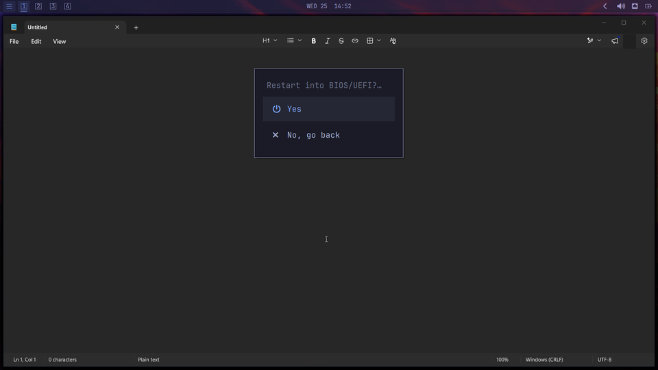). Yes restarted the VM straight into the OVMF
  firmware, which showed its boot device menu (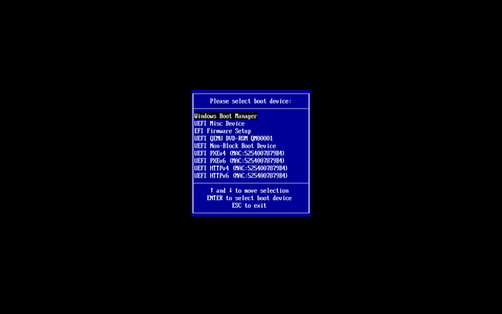). Choosing
  Windows Boot Manager booted back normally. The overlay was killed by the restart and
  left nothing behind: no PersonalizationCSP values, empty `C:\ProgramData\OmarchyOverlay`.
- **A3 Chrome** SKIP. Chrome isn't installed and Matt hasn't approved the download;
  the policy is verified on Edge.

## Build 15 (beb754e) — 2026-11-25 18:03 UTC, Windows 11 VM, Standard, clean settings folder

- **LS1** FAIL (Windows 11 Home, Spotlight off: RotatingLockScreenEnabled=0). Appearance >
  Apply theme to Windows > "Lock screen shows the theme background" shows "Windows did not
  change the lock sc…" (cut off) (); Win+L still shows the Windows
  default (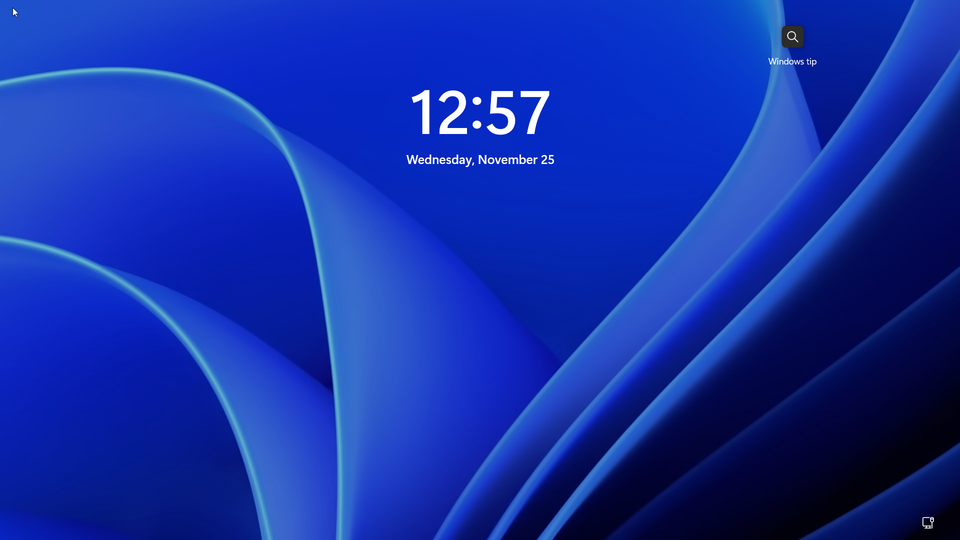). The log has only that message, no HRESULT.
  `lock-screen-original.jpg` was saved before the attempt.
- **Blocker after a failed LS1**: Exit also tries to put the original back, fails the same
  way (message 3× in the log) and leaves `lock-screen-original.jpg` behind. From then on
  every start shows a modal "Recovery needs attention. Saved records were preserved.
  Windows did not change the lock screen picture." (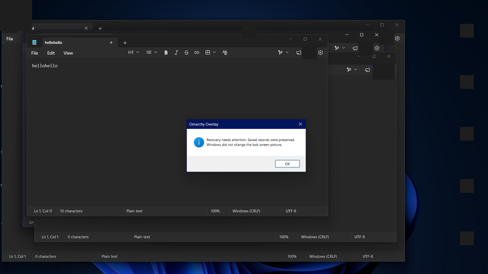) and the
  overlay **quits after OK**, so the Standard edition never starts again. Workaround:
  delete `%LOCALAPPDATA%\OmarchyOverlay\lock-screen-original.jpg`. Suggest: a lock screen
  restore failure should be a warning, not a recovery failure, and the saved file should
  be dropped when the picture was never changed.
- **CB1** PASS. Super+A selects, Super+C copies, Super+V pastes ("hellohello"), Super+X
  cuts; no clipboard history or Quick Settings opened (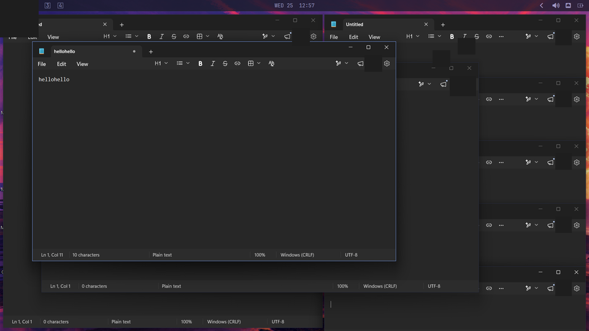).
- **O6** PASS. `remind 2 Test message` added the bar icon; after Exit and a restart (with
  the workaround) "Reminder: Test message" showed when due (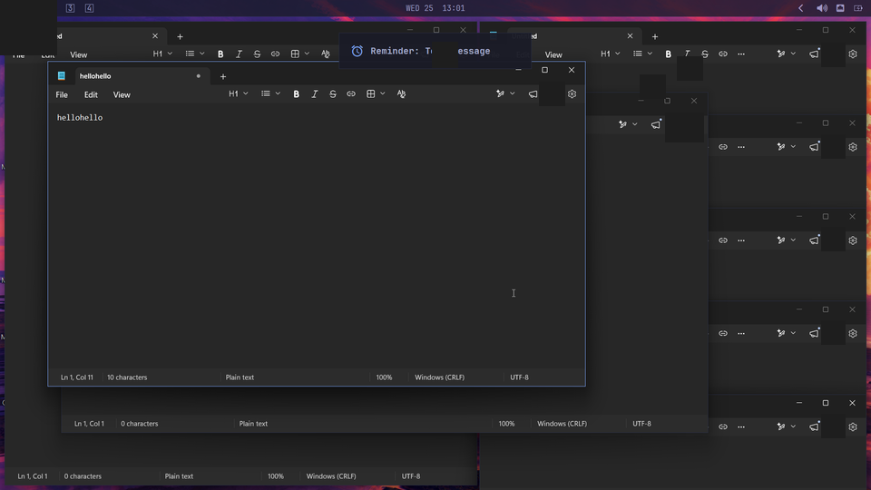);
  `reminders.json` held the due time.
- **K4** one screen only, so mirroring itself is untested. Super+Ctrl+Shift+Delete says
  "Windows did not mirror the screens: is a second screen connected?"
  (); Super+Ctrl+Delete says "Windows did not turn the laptop
  screen off: is an external screen connected?" (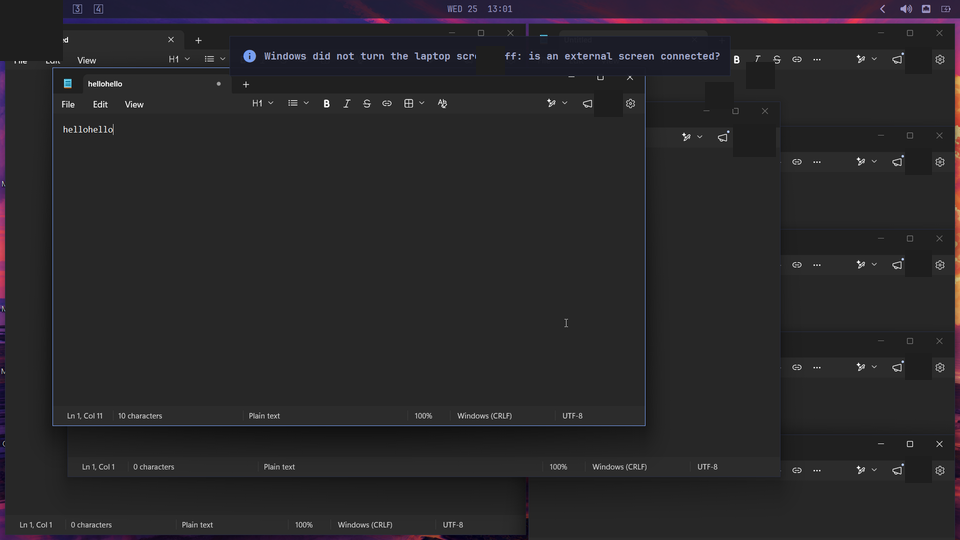). Sensible.
- Fresh folder: no `config.pre-0.5.0.json` this time before the first save.
- Not done yet: A2 retest and A3 (Admin), README screenshots. A3 on Chrome needs Chrome,
  which is not installed in the VM; asking Matt before downloading it.

## Build 13 (bb1af08) — 2026-11-25 20:55 UTC, Windows 11 VM, by hand, clean settings folder

Started from an empty `%LOCALAPPDATA%\OmarchyOverlay` (the old one is `OmarchyOverlay-old-12-suites`).

- **WL1** PASS. First start: the menu opened once (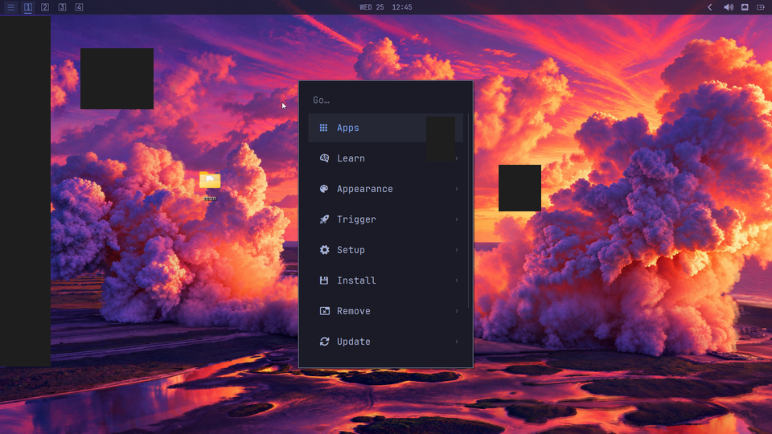) and
  `"welcomed": true` was written to config.json. Second start: no menu (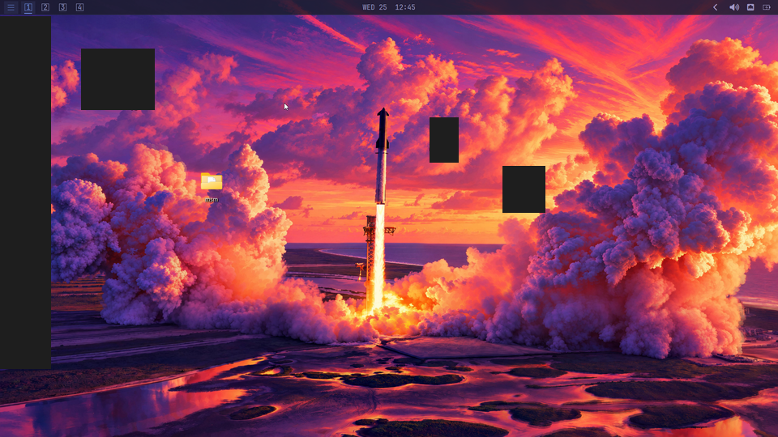).
- **A4 Standard** PASS. Appearance > Apply theme to Windows > Lock screen picture says it
  needs the Admin edition (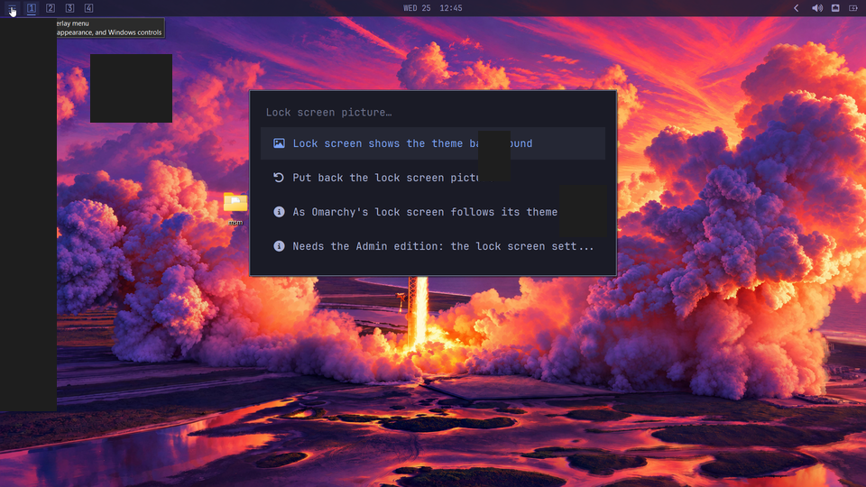). The header message is cut off
  ("The lock screen picture needs the …"), another truncated label.
- **A4 Admin** PASS on Windows 11 Home, no sign-out needed. "Lock screen shows the theme
  background" sets HKLM PersonalizationCSP LockScreenImagePath/Url/Status=1 to
  `C:\ProgramData\OmarchyOverlay\lock-screen.jpg` (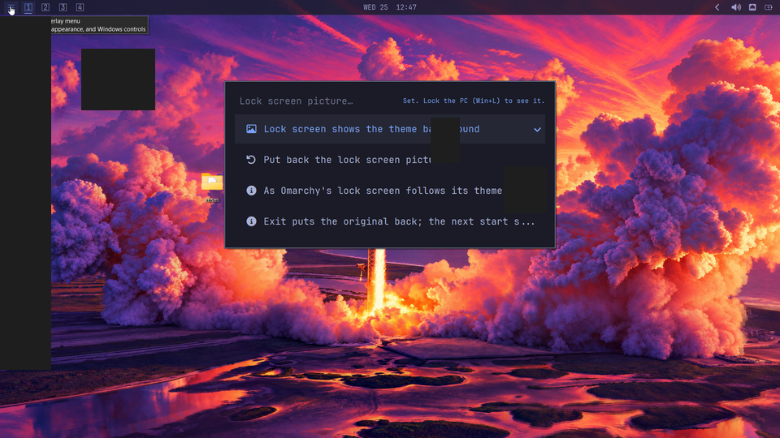). Win+L
  shows Tokyo Night's first background, `tokyo-night-0-liftoff.jpg` (hash match)
  (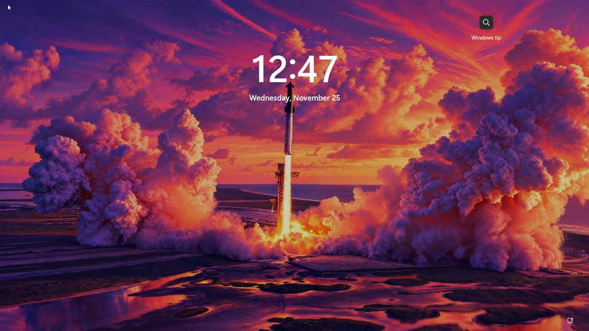). Switching to Gruvbox (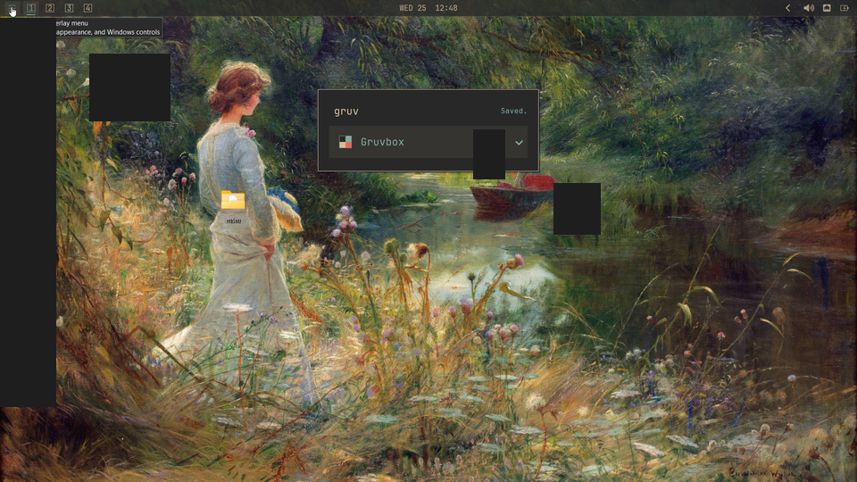)
  changes it to `gruvbox-1-the-backwater.jpg` (hash match) (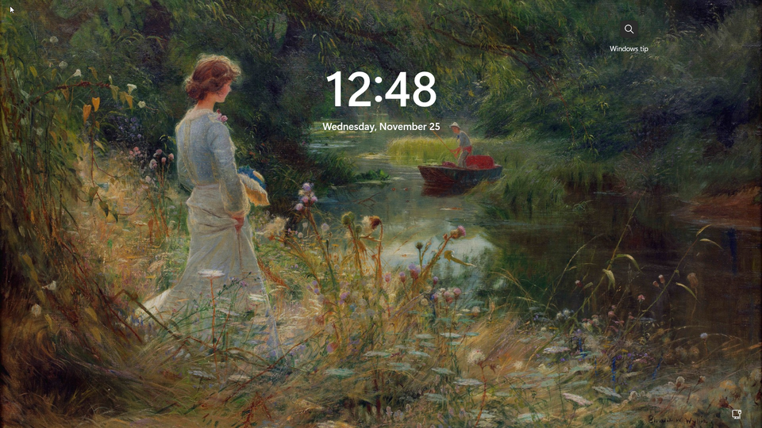).
  Exit removes the CSP values; the lock screen is the Windows default again
  ().
- **Opacity (Standard)**: Super+Backspace makes a tiled Notepad translucent and back
  (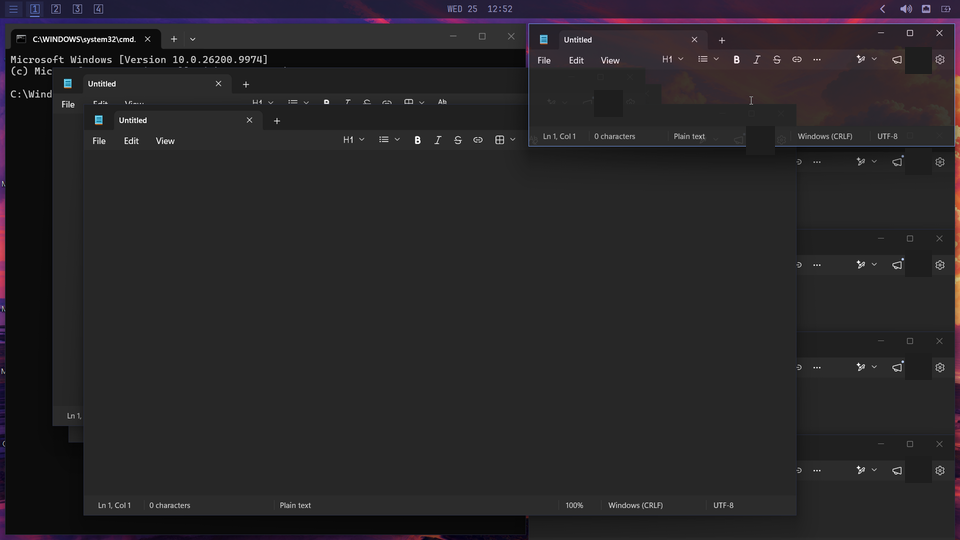), but does nothing on cmd, which Windows 11 now hosts
  in Windows Terminal (`CASCADIA_HOSTING_WINDOW_CLASS`; pixel diff empty,
  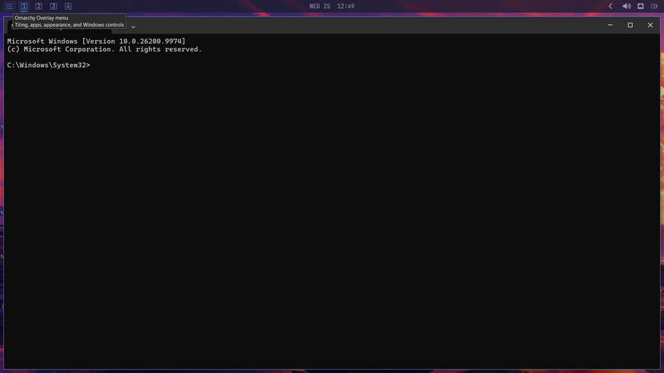). Not a regression check, just noting Terminal ignores it.
- **Untracked Notepads** still happen with a **clean** settings folder and no
  `workspace-layouts.json` anywhere (none in the old folders either; test_windows.py
  also deletes it before every suite), so that file is not the cause. Notepad restores
  its earlier tabs as several windows in one process (pid 3388). 5 were tiled, 3 floated
  untiled in the middle (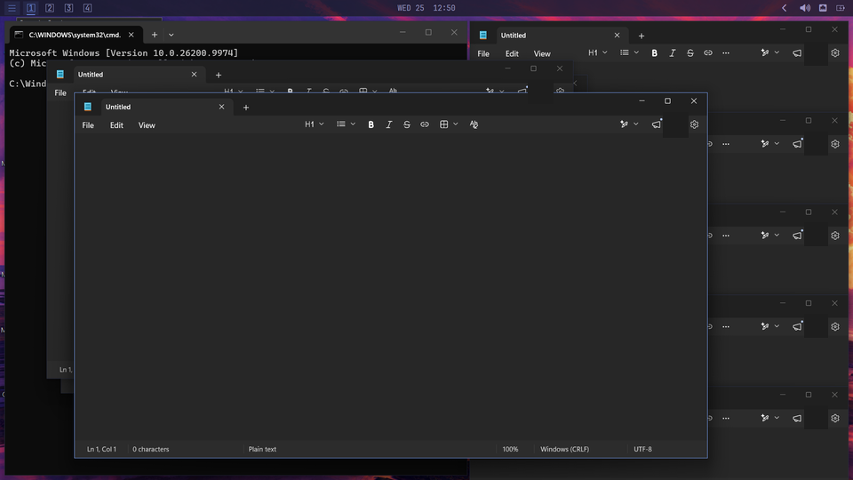), with identical
  class `Notepad`, style 14CF0000, exstyle 00000110, owner 0, not cloaked:
  tiled 30802, 40728, 40720, 407F2, 306F4; untiled 407A4 (128,166–1280,830),
  3073C (78,108–1038,687), 6029C (104,134–1064,713). A Windows Terminal window (1C05D0)
  was untiled too, while the cmd Terminal window (3F04D8) was tiled. The log says nothing
  about these windows. Looks like a race when one process opens several top-level
  windows at once, not leftover settings.
- **Leftovers confirmed** for the excluded list: a fresh config has 5
  `excluded_processes` (Taskmgr, mstsc, msrdc, ApplicationFrameHost, vmconnect); the
  36-entry list with conhost came from old settings. Odd: a **fresh** folder also gets a
  `config.pre-0.5.0.json`, although there was nothing to migrate.

## Build 13 (bb1af08) — 2026-11-25 VM suites, Windows 11 VM

- **VM suites** PASS after one test fix. All 23 default suites plus `standard` and
  `install` ran on the build 13 Standard exe and zips (Actions run 45659274637). The new
  `Ready()` works everywhere: no check failed because the menu no longer opens at
  every start, so smoke, customization and install needed no change.
- **bar-editor** failed on the module catalog count (24, test expected 23). The extra
  entry is the Indicators module from 6e4db53, so `tests/windows-bar-editor.ps1` now
  expects 24 (committed with this entry). Re-run: 16 checks, 0 failures.
- **tray** failed once on "auto-hide Tray button opens Explorer's real popup"; the re-run
  passed all 48 checks. Looks like a timing flake, not a regression.
- **standard** failed once on "Before: no Program Files folder": a leftover install from
  my manual Admin testing. The `install` suite removed it; the re-run passed all 19.
- WL1 and A4 by hand next, with a clean settings folder as asked.

## Build 12 (6d2c1aa) — 2026-11-25 18:00 UTC, Windows 11 VM, Admin and Standard

- **Labels and menu** PASS. The top menu shows the short labels (Apps, Learn, Appearance,
  Trigger, Setup, Install, Remove, Update). It opened by itself at start in both editions
  (); build 13 changes that.
- **A2 Admin** **FAIL**. System > Restart into BIOS/UEFI asks first
  (, ). On Yes, a classic unthemed
  message box says "Windows did not restart into the firmware setup. This PC may not use
  UEFI firmware." (). The VM is UEFI (OVMF, `firmware='efi'`).
  `shutdown /r /fw /t 120` returns exit 0 both as SYSTEM and as Matt elevated (I
  aborted both with `/a`). The System log has no event 1074 from the overlay's attempt,
  and the overlay log says nothing. So the spawn of `System32\shutdown.exe /r /fw /t 0`
  from the overlay fails or returns non-zero. Worth logging the status/error.
- **A2 Standard** PASS. It still asks first, then says it needs the Admin edition
  (). Asking first seems unnecessary when it can't do it.
- **A1 Admin**
  - Frames PASS. Apply theme to Windows > "Other apps' window frames follow the theme"
    turns on and saves (). The elevated cmd's title bar
    becomes the theme's #0A1028, the focus outline #1F5B77 shows, and it doesn't tile
    ().
  - Opacity **INCONCLUSIVE**. Super+Backspace on the focused elevated cmd changes
    nothing (pixel #0C0C0C before and after, tried 3 times). It works on Notepad. But
    `conhost.exe` is in `excluded_processes` (see below), so this is probably the
    exclusion, not elevation. I'll retest with a clean config.
  - Exit PASS. After Restore desktop and exit, the cmd has Windows' own title bar again
    and no outline ().
- **A1 Standard** PASS. The elevated cmd is left as it is.
- **A3 Admin** **FAIL for Edge**. "Chrome, Edge, Brave and Chromium follow the theme" says
  "Set. Restart the browsers…". It writes `BrowserThemeColor #0a1028` and
  `BrowserColorScheme device` under HKCU `Software\Policies\Microsoft\Edge` and
  `…\Google\Chrome`. After restarting Edge, edge://policy lists both with Status
  **Error: "Unknown policy."** (). Edge's toolbar takes
  the Windows accent (#2A3A78), not the theme. Edge doesn't support these Chrome
  policies. Chrome isn't installed in the VM, so Chrome is untested. Exit removed all
  four values (PASS).
- **A3 Standard** PASS. "Browser colors need the Admin edition" ().
  The row still shows a check mark, because `browser_colors: true` stays in the shared
  config.json after the Admin edition exits.
- **OB1** SKIP (Obsidian isn't installed in the VM). **W1 bar per monitor** not tested
  (the VM has one monitor).
- **Settings check (17:45 request)**. `config.json` `excluded_processes` lists 36
  processes, including explorer.exe, conhost.exe, WindowsTerminal.exe, OpenConsole.exe,
  Dropbox.exe and SnippingTool.exe. notepad.exe is **not** in it. `rules` has two
  powershell.exe entries: ignore, and tile for class OmarchyOverlay.ResizeFixture. So
  the exclusion explains File Explorer, but not the untracked Notepads.

## Build 11 (0a27206) — 2026-11-25 17:03 UTC, Windows 11 VM, Standard

- **K2** PASS. A lone Notepad on workspace 4 with Super+Ctrl+Backspace becomes a centred
  square (). A second Notepad tiles normally side by side
  (). Closing it brings the square back
  (), and the key again fills the screen
  ().
- **K3** PASS. Super+P on the right tile returns Notepad to its own height, centred
  vertically in the tile; its own width is wider than the tile, so it stays tile-wide
  (). Super+P again fills the tile.
- **TH1** PASS (git installed). Typing `theme-install bjarneo/omarchy-ash-theme` shows
  "Theme ash installed" within 3 s and the theme switches
  (, ). I didn't see
  "Installing…", which may just have been too quick. `config\themes\ash` holds only
  `colors.toml` and `backgrounds\` (1-ash.jpg, 2-dothash-dark.jpg).
- **close-all** (typed in the menu) PASS for tracked windows: the workspace 4 Notepad
  closed and workspace 1's tiled stack was left alone (). It
  didn't close the two untracked windows below, which show on every workspace.
- **O6**
  - Typed command PASS. `remind 2 Test message` shows "Reminder in 2 min" and the bar
    alarm icon ().
  - Persistence PASS. The icon is still there after killing and restarting the overlay
    ().
  - Notification **FAIL**. At the due time the icon goes away, but no Windows
    notification appears and Win+N shows "No new notifications". This happens with and
    without a restart (I also tried `remind 1`). Toast settings are at their defaults.
  - Control: a PowerShell NotifyIcon `ShowBalloonTip` does show
    (), so balloons work on this VM.
  - The log has these lines at every start, so the tray icon may not be registered
    when `NIM_MODIFY` sends the balloon:
    `Tray lookup: No supported hidden-icons control was found; SystemTrayIcon classes: []`
    and `Tray preparation: Tray control lookup failed (0x80004005)`.
- **Untracked windows**
  - The Notepad that Notepad restored at start never tiled
    (). The overlay was started right after Notepad
    in the same script, so the window may have appeared after the first scan.
  - Super+T floats it centred, and Super+T again puts it back at the same rect.
    Super+P does nothing.
  - After Super+Shift+2 it shows on every workspace, and so does an Explorer I opened
    on workspace 2.
  - On workspace 2 (Floating from earlier tests), Super+Shift+L showed "This workspace:
    Scrolling" but nothing moved.
  - One Super+3 press didn't switch.
  - I didn't save log lines before shutting the VM down. I'll grab them next time.
- **Menu at start**: still opens on every start (3 starts) in build 11. Build 12/13
  changes this.
- Exit from the menu restored the desktop; the bar and wallpaper went back to Windows.

## Build 10 (ddcd9bd) — 2026-11-25 16:46 UTC, Windows 11 VM

Standard zip runs portable from `C:\Users\Public\ovt\b10\std`. One 1920x1080 monitor.
Screenshots in `shots/10-*.png`.

- PASS BG1: both zips have `themes/<id>/backgrounds` (gruvbox has 6 jpgs).
- PASS K1 full-screen desktop (`10-K1-full`): Super+Ctrl+Alt+F hides the bar and the
  gaps, windows reach the screen edges; pressing it again brings both back.
- PASS K1 group keys: Super+G, then Super+Alt+Up moves a window into the group;
  Super+Alt+1 / Super+Alt+2 switch the active tab. The tab strip shows both windows.
- PASS K1 voice typing (`10-K1-voice`): Trigger → Voice typing opens the Windows
  dictation popup.
- PASS K1 hibernate (`10-K1-hibernate`): System → Hibernate asks "Hibernate?" first;
  chose No, nothing happened.
- Not tested K1 close-all: build 10 has no way to send a command from the command line
  (the exe only takes --restart, --install, --uninstall, --check-profile, --watchdog)
  and no menu entry for it. Will try it as a typed command in build 11 (O6). How is it
  meant to be run?
- Side note: one restored Notepad stayed floating in front while tiling was on. Not
  investigated; may be a window Notepad restored before tiling started.

## Build 9 (4c2a8d5) — 2026-11-25 16:45 UTC, Windows 11 VM

Standard and Admin zips run portable from `C:\Users\Public\ovt\b9`; Admin run
elevated. One 1920x1080 monitor, then two 1280x800 monitors for W1. Screenshots in
`shots/9-*.png`.

- PASS log at start: no `Font ""` line; tray lookup "selected SystemTray.NormalButton /
  Tray preparation: ready".
- PASS B1 (`9-B1`, `9-B1-tip`): mic off shows the mic-off icon, stay awake shows the cup.
  With both on only one icon shows (mic-off wins); the tooltip lists both. Is one icon
  at a time intended?
- PASS D8 (`9-D8`): "Dock always (auto-hides)" with the taskbar on auto-hide: pointer at
  the bottom shows the dock above the taskbar; both hide when the pointer leaves.
- PASS TRAY (`9-TRAY-std`): Standard and elevated Admin, the chevron opens the Windows
  overflow, no card, no freeze; the tooltip fits on one line. The card-width and
  tooltip-wrap fixes were not exercised because the lookup no longer fails.
- Labels (`9-labels-trigger`, `9-labels-taskbar`): Trigger and Toggle fit. Still cut:
  "Hide the Windows taskbar while Omarchy Overla…" (Appearance → Windows taskbar) and
  "Each monitor has its own workspaces (as in …" (Layout, `9-W1-label`).
- PASS P1 (`9-P1`): bar moves to the bottom, survives a restart, back to top shows
  "Saved.". Once, after the menu closed, the Windows taskbar showed over the bottom bar
  (during a Standard/Admin swap); not reproduced on a recheck. Not checked: tiles and
  dock with the bar at the bottom (tiling was paused).
- Main menu opens by itself at start (`9-menu-at-start`): seen twice with elevated
  Admin and once with Standard on two monitors.
- W1, two monitors (`9-W1-a2`): mostly PASS.
  - Super+2 on A hid only A's 5 windows; B's 2 stayed. Super+1 on A brought them back.
  - Super+Shift+3 on B sent the window to B's workspace 3; B's other window stayed.
  - Turning the setting off brought B's workspace-3 window back.
  - "Restore desktop and exit" restored all 7 Notepads, no process left.
  - FAIL bar: both monitors' bars show the workspace of the monitor last switched.
    After Super+2 on A, B's bar also shows 2, and still did after focusing B with
    Ctrl+Alt+Tab. (The VM pointer cannot reach monitor 2, so I could not click a window
    on B; focus came from Ctrl+Alt+Tab.)
  - A Photos window that was open on A, untiled, appeared when A switched to 2.

## Build 7 (2c3f776) — 2026-11-25 15:20 UTC, Windows 11 VM, 1 monitor at 125%

Standard zip, run portable from `C:\Users\Public\ovt\b7\std` as a standard user, with a
user `config\binds.conf` and `menu.json` seeded from build 6's examples (one line edited).
Theme Gruvbox. Screenshots in `shots/7-*.png`.

- PASS M1: new keys added at the end under "# Added by Omarchy Overlay", my edited line
  kept, `binds.conf.before-0.5.0` and the menu.json backup written, Appearance gained VS
  Code colors, Window transparency and Screensaver and idle lock. Not checked: whether
  unedited lines follow changed defaults (none of the seeded lines changed between 6 and 7).
- PASS F7 (`7-F7`): first press shows "Gaps off" and takes away edge and inner gaps;
  second shows "Gaps on" and puts them back. No opacity change.
- PASS C1, S1, G1 (`7-G1`: tab strip with 2 tabs, "Group 2/2").
- PASS T1 (`7-T1`): red is #EA6962, background #282828, but only after Terminal is
  restarted; a Terminal already open when Add is clicked keeps Campbell (#E74856).
- PASS R1 / exit: wallpaper set to a theme background, then Update → Process → Restore
  desktop and exit. Wallpaper back to `img19.jpg`, taskbar and windows restored, no
  process left. Windows reported the real `img19.jpg` path, not `TranscodedWallpaper`,
  so the new `wallpaper-original.jpg` copy was not exercised.
- FAIL B1 icon: tooltip is right (`7-B1`: "Stay awake is on / Microphone is off") but the
  icon stays the keyboard glyph. Keyboard-layout part untested (one layout).
- FAIL D8 (`7-D8`): "Dock always (auto-hide)" with the Windows taskbar on auto-hide:
  pointer at the bottom shows both, and the dock tile overlaps the taskbar instead of
  sitting above it. Both hide when the pointer leaves. "No dock" shows only the taskbar.
- TRAY (Standard, `7-TRAY`): card "…tray could n…" (cut off) and a tooltip "Tray control
  lookup failed (0x80004005)…" that runs off the right edge. No freeze. Admin not tested.
- Labels cut off in many menus (`7-labels`): "Layouts by works…", "Screensaver and …",
  "Choose a section, …", "Left …", "Right…", "Running apps and t…", "Clipboard h…",
  "Screen reco…", "Add the …", "Open Windows Termi…", "Run Add again afte…".
- Log at start: `Font "" is not available; Segoe UI is used instead`.

## Build 6 (02242fa) — 2026-11-25, Windows 11 VM (partial, superseded by build 7)

- The Actions exe starts: the manifest fix works.
- PASS F7: toggled the inner gap 0 ↔ 5 only (edge gap unchanged), as the cloud found.

## Pre-build 5 (f5ed887) — 2026-11-25, Windows 11 VM, 1 monitor at 125%

Tested before Build 5 existed, from the Standard and Admin zips with the exe built
locally at f5ed887. Standard as a standard user; Admin installed with INSTALL.cmd for an
administrator (logon task, elevated). No screenshots: the VM desktop shows private items.

**Blocker for every Actions build: the exe won't start.** lld-link 18 on the Ubuntu
runner merges a second trustInfo into the manifest and writes `ms_asmv1:level`, which
Windows refuses to load. Fixed on main by matthewjaybarr-png/omarchy-overlay#31
(`build.rs`: `println!("cargo:rustc-link-arg=/MANIFESTUAC:NO");`). This branch needs it
too (merge main or cherry-pick), or no Actions artifact can be tested.

- PASS F2, F3, F4, D1, D2, D3, D4, D6, D7, D8, D9, D10, T1, F8 (Standard and Admin)
- FAIL F1: centred and staggered 24 px, but about 57% of the screen wide, not two-thirds.
- FAIL F7: Super+Shift+Backspace is still bound to restoring window opacity; gaps don't toggle.
- PASS F5 (re-tiles when cycling back); the Super+T part was not tested.
- PASS F6 (cycles backwards); "workspace 2 unchanged" was not checked.
- PASS D5, but Keep in dock is greyed out for apps with no picker entry (Dropbox).
- T1 note: the fragment's black, brightBlack and brightWhite are Tokyo Night constants
  (`appearance_profiles.rs` ~148), not theme colours.
- Dock: unpinned icons reorder by z-order on every focus change.
- Dock: with the taskbar on auto-hide, the popped-up taskbar overlaps the dock, or the
  dock covers its Search box.
- Menus: labels are cut off in the dock options and "Apply theme to Windows"
  (e.g. "Windows d…", "Acc…").
- F8 note: after the Standard exit the wallpaper was black; the original wasn't checked.
- **Admin bug: a hidden message box freezes the overlay.** Clicking the bar's TRAY button
  fails ("Tray control lookup failed (0x80004005)…"; log: "No supported hidden-icons
  control was found; SystemTrayIcon classes: []") and shows a message box *behind* the
  other windows. Until its OK is clicked, keys, tiling and the bar clock all stop.
  Suggest a non-modal toast/OSD instead, or at least MB_SETFOREGROUND|MB_TOPMOST.
- Admin: keys work while an elevated cmd window is focused. Elevated windows are not
  tiled (the `elevated()` filter); fine if intended, but the README only says "keys".

